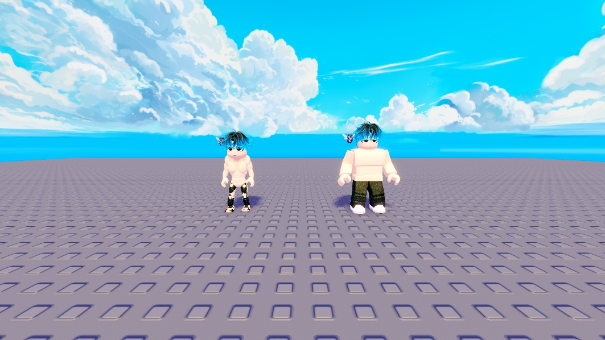
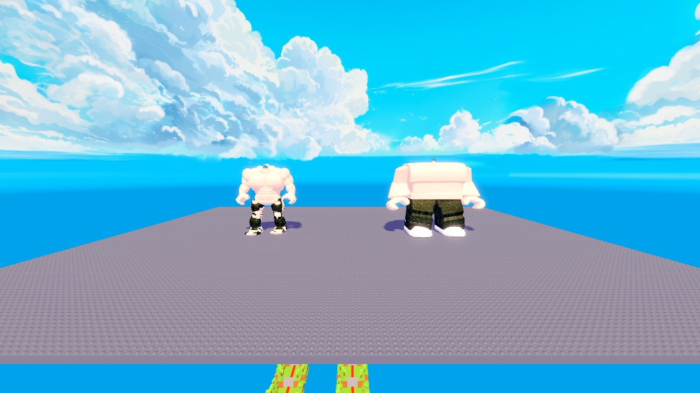
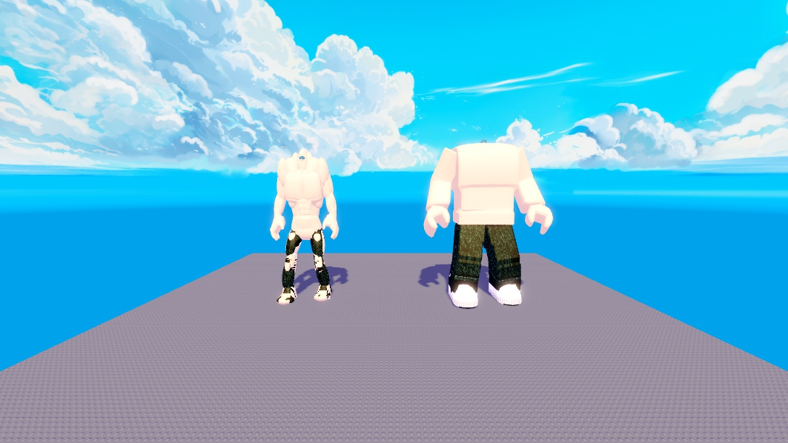

# Studio Body比較試作 — 2026-11-16

**副本で採否を判断するための試作。正式採用・公開反映ではない。** 開始基準は `7fe76dcde8f2794f745b99f708a89ba4945c6f11`。現在のStudio Source・モデルを照合し、未保存編集を維持して実装した。対象接続は PlaceId **126576845524886**、UniverseId **10765181857**。最新の「致命的な不具合がなければ進める」指示を受け、確認済みの主要動作をもとに提出し、未確認を下記に残した。

副本は **Enabled=true・未保存Edit・開いたまま**。次のPlayで右上の比較UIを使える。Save／Publish、正本、PR #1、公開サーバー、Robloxアプリは操作していない。GitHubへの通常pushはソースと報告の反映であり、Placeの公開操作ではない。

## 操作

1. Play開始直後は本人の通常Body・保存済み表示設定。右上の「Body比較・Studio」はWin／再生回数／既存SIZE解放に依存しない。
2. 「通常Body」「筋肉Body」を押す。成長段階／手動倍率の選択を保持したまま同じCharacter内で切り替える。
3. 成長段階はLV1／2／4／8／16／32／50／70／90／115／140相当。実LV・Strengthは変更しない。
4. 手動倍率は各BodyのLV1が基準。身長と太さを独立指定し、数値欄の直接入力または±ボタンで **0.01刻み**。入力・表示は小数第2位。身長 **1.00～10.00**、太さ **1.00～10.00**。3倍の身長上限は撤回、太さ10倍は維持した。10倍の身長上限は比較UIの実装上の入力範囲であり、正式な成長曲線ではない。
5. プリセットは身長×太さで **1.00×1／1.75×3／2.75×5／4.00×7／5.00×10**。これも正式なLV曲線ではない。
6. 下へスクロールして「比較解除」を押すと、通常Bodyと保存済みSIZE／実LVに応じた表示・元の衣服へ戻る。選択値は保存せずPlay終了で破棄する。
7. 試作全体のOFFは **ServerStorage.BodyPrototype_20261114 → Attribute Enabled=false** として次のPlay。trueで再度UIが使える。

切替中は入力を抑止し、完了・失敗を表示する。比較中だけ手動ズーム上限220へ拡張、解除で元の範囲へ戻す（実測18～30）。カメラ角度・距離をコードから自動設定しない。

## 最新の衣服仕様

前回の裸固定・仮短パン強制、および途中の「全衣服を可視保持」を最新指示で置き換えた。比較中は **Classic Tシャツ（ShirtGraphic）とClassicズボン（Pants）を可視のまま保持**。Classicシャツ（Shirt）はテンプレートを一時的に空にし、Layered Clothing・靴はTransparency／WrapLayerで非表示にする。服Instanceは削除せず、比較解除で元値を戻す。

今回の本人アバターはShirt＋Pantsで、ShirtGraphicは未装着。従って比較中に上半身のShirtは見えなくなる。Classic Tシャツ保持は合成したShirtGraphicでの構造確認であり、本人が着用したTシャツの実描画確認ではない。髪・顔・帽子系と、服に分類されない肩アクセサリーは保持する。アカウント側の外観は変更しない。

同じHead、FaceControls、顔テクスチャ、Attachment、髪・アクセサリーInstanceを保持。普通のBodyへ戻すと同じ元部品・衣服値へ戻る。仮短パンは生成しない。Classic PantsのUV分断・伸び、巨大サイズでの顔が胴に隠れる見え方は残る。顔Instanceの消失とは区別し、今回美術調整は行わない。

## 変更Full Path

|Full Path|変更|
|---|---|
|ServerStorage.BodyPrototype_20261114.PlayableBodyPrototype|14部位の事前準備・可逆交換、通常関節の保管、顔／装着品接続、衣服可視状態、絶対寸法、身長計算、失敗復元。[Source](../prototypes/BodyPrototype_20261114/PlayableBodyPrototype.luau)|
|ServerStorage.BodyPrototype_20261114.PlayableShapeConfig|試作の手動入力範囲。既存試作のLV端点は保持。[Source](../prototypes/BodyPrototype_20261114/PlayableShapeConfig.luau)|
|ServerStorage.BodyPrototype_20261114.PlayableComparisonService|新規。プレイヤーごとの一時設定、入力検査、切替排他・確認通信、UI生成。[Source](../prototypes/BodyPrototype_20261114/PlayableComparisonService.luau)|
|ServerStorage.BodyPrototype_20261114.ComparisonClient|新規LocalScriptテンプレート。比較UI、0.01入力、切替確認、手動ズーム範囲。[Source](../prototypes/BodyPrototype_20261114/ComparisonClient.client.luau)|
|ServerScriptService.Systems.Controllers.MuscleCharacterService|条件成立時だけ比較へ分岐。実LV／保存SIZEによる比較中の上書きを抑止。[Source](../src/ServerScriptService/Systems/Controllers/MuscleCharacterService.server.luau)|
|ServerScriptService.Systems.Controllers.DumbbellDisplayController|比較表示コピーの倍率・握りを更新し、手の交換時に再接続。[Source](../src/ServerScriptService/Systems/Controllers/DumbbellDisplayController.server.luau)|

Play中だけ生成するもの：`Players.<player>.PlayerGui.BodyComparisonGui`、`ReplicatedStorage.BodyComparison.Request`、`ServerStorage.BodyPrototype_20261114.RuntimeBodyComparison`。非表示の旧Body部品はServerStorageのキャッシュに保管し、Character終了時に解放する。

`LobbySpawnService` は今回変更していない。現行フック、退出判定、要求所有権、二重生成防止、streaming／配置／接地を利用する。`MuscleScaleConfig`、`SizeChangeConfig`、`SizeChangeClient`、装備テンプレート、保存・価格・報酬・HP・攻撃計算は変更しない。

Gitには上記Source、[配置確認コマンド](../prototypes/BodyPrototype_20261114/InstallPlayableAssets.luau)、[構造／模擬テスト](../prototypes/BodyPrototype_20261114/ValidatePlayablePrototype.luau)、本報告、SPEC更新と指定の比較JPEG3枚を収録。新しいローカルフォルダー、Place複製、モデル丸ごとの大型ファイルは作成していない。過去のPlayable_LV*／ArchivedPreviewsは履歴モデルとして保持し、現在の服仕様の展示と混同しない。

## 公開ゲームへの隔離

生成フック、成長分岐、試作Module、サーバー操作受付は **IsStudio()・対象PlaceId・Enabled=true** の全条件を確認する。条件判定は試作依存Moduleのrequire、イベント接続、Body変更より前。非StudioではEnabled=trueでも通常経路へ進む。UIテンプレートはServerStorage内で実行されず、条件成立時だけサーバーがPlayerGuiへコピーする。

実PlayのOFF確認では、通常Body・元Shirt/Pants・健康100・アンカー解除を確認し、比較UI／Remote／管理Attribute／キャッシュ生成はなかった。再びONの新規Playで比較UI、筋肉1.25×10への切替、解除を確認した。非Studio／対象外Placeは実公開環境で試さず、実ソースへ条件を注入した模擬検証で、条件外の依存初期化0件を確認した。

試作ONの管理Characterでは、エンジンの自動スケールが保存SIZEを上書きするのを防ぐため、比較解除後もAutomaticScalingEnabled=falseとして通常Configから寸法を計算する。これはStudio限定管理経路の仕様。OFFで次のPlayでは元のAutomaticScalingEnabled=trueに戻ることを確認した。

## 比較画像と寸法

以下は今回の**実PlayのCharacterから作った静止コピーの実描画**。左が筋肉、右が通常。撮影用台・コピー・GUI非表示は検証補助で、Stop／復元で除去した。操作中の動画ではない。画像のカメラ距離は各行で異なるため、画像間のピクセル比較ではなく寸法表を使う。JPEG3枚合計約579 KiB。

寸法単位はstud。身長は直立関節配置における**左右Foot箱下端から本人Head箱上端**。髪／帽子込み外接サイズや、皮膚三角形の最上端ではない。構造検証では実Part CFrameの箱端からも照合した。太さは各部位のX幅・Z厚みで、頭は倍率対象外。

|Body|LV1基準身長|5×10プリセット身長|10×10入力最大身長|
|---|---:|---:|---:|
|通常|5.015680|25.078401|50.156802|
|筋肉|4.498788|22.493937|44.987881|

|部位（左右は左側を代表）|通常LV1 幅/厚み|通常10倍 幅/厚み|筋肉LV1 幅/厚み|筋肉10倍 幅/厚み|
|---|---:|---:|---:|---:|
|UpperTorso|1.8391 / 1.0733|18.3908 / 10.7331|1.2437 / 0.6288|12.4374 / 6.2882|
|LowerTorso|1.6722 / 1.0374|16.7224 / 10.3744|0.9775 / 0.6439|9.7747 / 6.4392|
|LeftUpperArm|0.9424 / 0.7589|9.4244 / 7.5894|0.4148 / 0.4049|4.1475 / 4.0489|
|LeftLowerArm|0.8119 / 0.9023|8.1186 / 9.0227|0.3292 / 0.3185|3.2924 / 3.1853|
|LeftHand|0.7531 / 0.7729|7.5315 / 7.7295|0.4729 / 0.4585|4.7288 / 4.5847|
|LeftUpperLeg|0.7808 / 0.8536|7.8077 / 8.5360|0.4439 / 0.5013|4.4395 / 5.0132|
|LeftLowerLeg|0.7214 / 0.8536|7.2139 / 8.5360|0.3837 / 0.3850|3.8370 / 3.8505|
|LeftFoot|0.7214 / 1.2430|7.2139 / 12.4300|0.5143 / 0.9074|5.1430 / 9.0744|

全14部位のX/Zを基準から計算。5×10と10×10は同じ横幅・厚み。Headは両Body・全比較で **1.195015×1.195231×1.203906** を保持。胴のY倍率を身長倍率と呼ばず、頭を変えずに目標の足裏～頭頂へ合わせるY倍率を解く。

## 検証結果と限界

|区分|今回確認した内容|
|---|---|
|実Play・状態|両Body×11成長段階＋独立手動7組の計36適用。同じCharacter／Headを保持、健康100。実LV／Strength／Win／再生回数／保存SIZE／装備データは比較操作前後で一致|
|実Play・反復|巨大5×10の12回切替で死亡なし、RequiresNeck復帰、アンカー解除。位置補正修正後8回の横移動累積は約0.000001stud|
|実Play・入力／描画|実マウスでBody／プリセット／0.01加算。ネイティブTextBox FocusLost経路で1.25適用。外部キーツールの文字入力は安定しなかったため、物理キーボードによる数値文字列入力の全操作を確認済みとはしない|
|実Play・死亡／連打|20並行要求で適用1回。切替準備中の死亡後、既存生成経路で復帰し、前の確定設定・装備を維持。キャッシュは現Characterの1件。単独クライアントでの確認|
|実Play・保存SIZE復帰|比較中にテスト用メモリSIZEを5へ設定しても比較寸法・pose revisionは維持。解除後、通常stage5のUpperTorso寸法が通常Configの4.045971／3.353785／2.146624と一致。SIZE変更自体は検証準備であり比較UIの動作ではない|
|実操作・移動|実D/Aキー・Spaceで両Body基準と5×10の歩行、停止、ジャンプ、着地。健康100、停止後MoveDirection=0。移動距離約27～32stud|
|実Play・接地|筋肉基準の静止Foot箱床差−0.007～−0.011、筋肉5×10は−0.077～−0.151、通常基準−0.279～−0.252、通常5×10は+0.032～+0.155stud。負値は箱が床より下。アニメーション・箱とメッシュの差を含み、全姿勢の接地ゼロ保証ではない|
|実Play・装備|ダンベル2個を保持。基準→5×10で通常表示scale1→3、筋肉0.5→1.5。共有テンプレート／装備データは不変更。筋肉Motor接続差は代表最大約0.000031stud。通常のAnimationConstraint全関節の動的残差は未測定|
|実Play・設備|両Bodyの基準でWorld1 Treadmill＋7、World2＋35（各0.5秒×7サンプル）、退出で停止。既存配置／実設備加算を使用。World2解放・LV初期化は隔離メモリでの検証準備|
|実Play・巨大設備|5×10ではWorld1で両Bodyとも接触が途切れ、同時間に加算0。World2は両Body＋35。巨大サイズと設備の収まりの制約として残し、設備やバランスを変えていない|
|実Play・最終ON/OFF|OFFで通常処理・UIなし→ON新規PlayでUI→筋肉1.25×10→解除。全経路健康100、アンカー解除、プロフィール不変。カメラCustom・解除後zoom上限30|
|構造／模擬|23ケース・453 assertion。Body／比較Serviceの3条件全8組ずつ、不正範囲／NaN／小数丸め、部品不足、古い要求、交換後エラー注入で復元、反復、服保持・復元、全成長、通常Config不変更|

検証中に見つけて修正した問題：
- Body交換の複製反映中に首接続が一時的に不完全となる状況と整合する死亡を観測。Prepare→Commit→Ready→Releaseで首検証を保留し、現Bodyの関節・14部位の反映確認後に戻す。既存配置要求の所有権を利用し、失効した処理は新しいCharacterへ書き込まない。タイムアウトは元設定へ復元し、確認できない場合だけ現行LoadCharacter経路へ一度渡す。自然な通信障害の全種類は未確認。
- 接続済み部位／アクセサリーのCFrame書込みで横へずれる問題は、接続更新完了後にRoot姿勢を戻して修正。
- 数値入力でgsubの戻り値2個がtonumberへ渡るエラーを修正。
- 比較解除時の保存SIZE寸法をエンジン自動スケールが上書きする問題を修正。比較中は実LV／保存SIZEの更新で再適用しない。

**残る確認・制約：**
- 今回版での壁／Bossへの攻撃、再生操作そのもの、複数の実クライアント、実切断・再参加、巨大10×10での全設備操作は未確認。前回報告の成功を今回版の実Play成功として転記していない。
- 本人の顔・髪はデータとして保持するが、巨大倍率では胴に隠れて見える。Pantsは筋肉BodyのUVで分断・伸びが見える。許容された衣服崩れの範囲は記録に留め、ケージ・服・メッシュ美術修正を行っていない。
- 最大BodyのWinTrophyは既存据置。今回の悪化有無は未確認。巨大な腕脚の設備干渉やジャンプの変化もある。
- PC Studioの描画／操作であり、今回の比較UIの実スマホ／タブレット／ゲームパッド検証、公開環境確認ではない。
- 最終Playで今回のSource由来のRuntime Error／Warning／Infinite Yieldは検出しなかった。既存の未承認アセット／Images/wd欠落ログは残る。「バグがない」「全衣服が正常」とは判定しない。

## 後始末・保持

本番DataStore・課金・Badge／Messaging等は検証中だけメモリ代替し、39 Sourceの一時置換を元の**作業開始時Source**へ復元した。製品変更4 Sourceとは対象が重ならないことを照合後に復元。最初の一括復元は自動レビューで製品変更を巻き戻す懸念により拒否されたため、対象全39件と製品4件の非重複・復元前後値を読み取り検証し、製品Source除外を強制した処理で完了した。

最終監査：開始時513 Source中 **509保持・4変更**、製品Source **2追加**で計515。保護対象モデル等 **2125 Instanceの記録プロパティ差分0**。検証補助・メモリ代替・一時モデルなし、StarterPlayer.StarterCharacterなし、Edit内比較Remoteなし。試作資材・製品Module／UIテンプレートは残し、Enabled=true。既存通常設定、旧モデル、未保存編集を保護して終了した。
