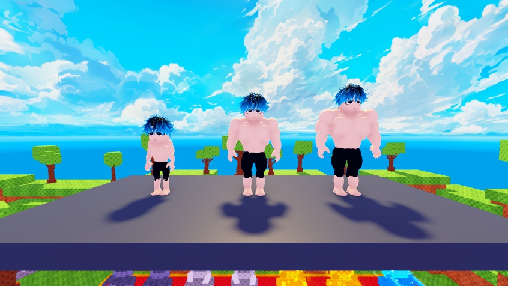
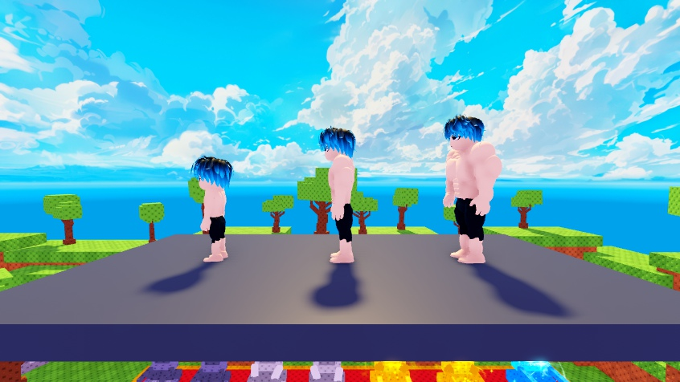

# 専用筋肉Body・操作可能な試作 — 2026-11-16

**採否判断用の試作。正式採用ではない。** 副本Studioへ実装し、終了時は `Enabled=true`・未保存Editで開いたままにした。次のPlayでは現在のLV／既存SIZE選択に対応する試作Bodyを使う。OFFで次のPlayから通常Bodyへ戻る。Save／Publish、正本、PR #1、公開サーバー、Robloxアプリは操作していない。

対象は実接続で確認した PlaceId **126576845524886**、UniverseId **10765181857**。既存の[前回試作](BodyPrototype_20261114/REPORT.md)、[モデル調査](StarterCharacterInvestigation_20261114/REPORT.md)、試作ソース、現在のMuscleCharacterService／MuscleScaleConfig／LobbySpawnServiceを照合し、今回開始時のStudio Source・Editorとモデルを基準に変更した。Gitの開始基準は `09f2e79a5fa4f93d98337f134d3cae5c18f3f48b`。

## 操作と切替

1. 副本StudioでPlayを開始する。通常の操作で歩行・ジャンプ・設備利用ができる。LV1固定やデータリセットは行わない。
2. 通常Bodyへ戻す場合はStopし、Explorerで **`ServerStorage.BodyPrototype_20261114`** を選び、PropertiesのAttributesにある **`Enabled`** を `false` にして次のPlayを始める。
3. 同じAttributeを `true` に戻して次のPlayを始めると試作へ戻る。Play途中の即時着替えは今回の仕様に含めない。

ON／OFFの正本はこのAttribute一か所。`IsStudio()`、対象PlaceId、Enabledの3条件をすべて満たしたときだけ、生成側・成長側が試作Moduleをrequireする。Module自身にも初期化前の同じ判定を置いた。非StudioではEnabledがtrueでも通常処理へ進み、試作由来の衣服削除・Body生成・追加接続を行わない。UniverseIdは作業接続と資材配置コマンドで確認している。

## 変更Full Path

| Full Path | 変更とGit上の所在 |
|---|---|
| `ServerScriptService.Services.LobbySpawnService` | 現行LoadCharacterAsyncの完了・要求確認後、SpawnEngineReady前に組立。現在のPlayer／Character／要求／生成所有者を再確認。既存の退出・待機・streaming・配置経路を維持。[Source](../src/ServerScriptService/Services/LobbySpawnService.luau) |
| `ServerScriptService.Systems.Controllers.MuscleCharacterService` | 組立済み試作だけ専用成長へ分岐。通常Config・通常Body処理を保持し、CharacterRemovingで試作の参照を解放。[Source](../src/ServerScriptService/Systems/Controllers/MuscleCharacterService.server.luau) |
| `ServerScriptService.Systems.Controllers.DumbbellDisplayController` | 試作Characterの表示コピーだけ縮尺と握り位置を調整。通常の表示寸法・装備・効果は保持。現在のStudio Sourceを基に今回初めてsrcへ収録。[Source](../src/ServerScriptService/Systems/Controllers/DumbbellDisplayController.server.luau) |
| `ServerStorage.BodyPrototype_20261114.PlayableBodyPrototype` | 新規Module。全身事前検査、交換と失敗時復元、本人Head保持、肌色、短パン、絶対寸法による成長。[Source](../prototypes/BodyPrototype_20261114/PlayableBodyPrototype.luau) |
| `ServerStorage.BodyPrototype_20261114.PlayableShapeConfig` | 新規Module。試作専用の部位別XYZ倍率と成長曲線。通常設定を変更しない。[Source](../prototypes/BodyPrototype_20261114/PlayableShapeConfig.luau) |
| `ServerStorage.BodyPrototype_20261114.PlayableSourceBody` | 元モデルから作った試作用の基準コピー。元メッシュ／UVを編集せず、この基準寸法から毎回計算 |
| `ServerStorage.BodyPrototype_20261114.Playable_LV1` / `Playable_LV32` / `Playable_LV140` | 保管用の静止比較モデル。Scriptを含めず、Workspaceに常設しない |
| `ServerStorage.BodyPrototype_20261114.StarterCharacter` | 旧 `Workspace.StarterCharacter` の同じInstanceを保護して移動 |
| `ServerStorage.BodyPrototype_20261114.ArchivedPreviews` | 旧 `Workspace.BodyPrototype_20261114` を改名して移動。過去の展示を保持 |

既存の `ServerStorage.BodyPrototype_20261114.SourceBody`、`CurrentAvatarReference`、`Clothing`、旧 `BodyPrototype` は保持。`StarterPlayer.StarterCharacter` は設置していない。無関係なWorkspaceモデルは変更していない。

[InstallPlayableAssets.luau](../prototypes/BodyPrototype_20261114/InstallPlayableAssets.luau) は、既存資材と今回の2 Module・3 Sourceから保管構造を再現するEditコマンド。常駐Scriptではない。[ValidatePlayablePrototype.luau](../prototypes/BodyPrototype_20261114/ValidatePlayablePrototype.luau) は再現可能な構造／失敗注入テストであり、Studioに常設していない。Gitにはソース・配置手順・報告・指定された比較画像3枚を収録し、Place丸ごとの重い複製は作成していない。既存フォルダーを使用し、新しいローカルフォルダーは作っていない。

## 外観・成長・比較画像

比較画像は**今回のStudio Play内で、実Characterから作った静止比較コピーを実描画**したもの。左LV1、中央LV32、右LV140。操作中の連続動画ではない。比較用の台とWorkspaceコピーはPlay停止で除去した。依頼された3枚だけを保持する（合計約417 KiB）。

寸法はstuds。XYZはMeshPartの箱寸法、外接寸法は髪を含む静止モデルの箱。皮膚の三角形から測った寸法ではない。

| 寸法 | LV1 | LV32 | LV140 |
|---|---:|---:|---:|
| UpperTorso XYZ | 1.244 / 1.943 / 0.629 | 2.139 / 2.827 / 1.214 | 2.487 / 3.170 / 1.441 |
| UpperArm XYZ | 0.415 / 1.238 / 0.405 | 1.012 / 1.795 / 0.933 | 1.244 / 2.012 / 1.139 |
| Hand XYZ | 0.473 / 0.642 / 0.458 | 0.619 / 0.822 / 0.597 | 0.676 / 0.892 / 0.652 |
| 髪込み外接 XYZ | 2.089 / 5.031 / 1.817 | 3.493 / 6.405 / 1.817 | 4.142 / 6.940 / 1.845 |
| HipHeight | 1.690251 | 2.445544 | 2.739269 |
| 本人Head XYZ | 1.195 / 1.195 / 1.204 | 同左 | 同左 |

LV1は全身一律30％／40％ではなく、胴の幅・厚み、腕脚の太さ、長さ、手足を別々に調整した。例えばUpperTorsoは元のXYZに対し0.30／0.38／0.24、UpperArmは0.16／0.32／0.16。LV1は中盤以降より明確に小さく細いが、**元メッシュに彫られた胸・肩の筋肉の輪郭は残る**。頂点編集による細身メッシュを完成したという判定ではない。頭・髪はLV1に対してまだ大きく見える。輪郭まで非筋肉質にする場合は、基準コピーのメッシュ形状を作り直す候補が残る。本人のHeadを機械的に縮小する変更は採用していない。

成長時点は従来の **LV1／2／4／8／16／32／50／70／90／115／140**。端点間の進行度は `0, .20, .36, .50, .62, .72, .80, .87, .925, .97, 1` で、序盤ほど変化量が大きい。通常Bodyの倍率は重ねない。部位寸法・Attachment・Motor C0/C1・短パン・握り位置を保存済み基準から計算する。毎回の現寸法へ倍率を掛ける累積方式ではない。既存AUTO／SIZE選択を維持する。

本人のHead Instanceをそのまま使い、実AvatarのHead MeshId `117643569671751`、FaceControls 1個、SurfaceAppearance、WrapTarget、Neck／Hair／Hat／FaceFront／FaceCenter Attachmentを保持。髪 `Accessory (Messy Middle Part Hair)` も残った。BodyColorsの本人色RGB **230/191/154**を首から下へ引き継ぎ、顔・髪のテクスチャは塗りつぶしていない。Headの首Attachmentに接続する15 Motor6DのR15構造を組み立てる。

上半身を覆う衣服・Bodyアクセサリー・靴は試作Characterから外す。アカウント外観、元参照モデル、通常Bodyには作用しない。ズボンはClassic Pantsを再利用せず、LowerTorso・左右UpperLegに合う**黒いメッシュ殻3部品の仮短パン**とした。少し外側へ広げてBodyに溶接し、成長とアニメーションに追従する。正面・側面・背面で腰・股・上脚の連続した黒い被覆を確認し、前回のClassic模様の分断は使わない方式で回避した。裾の輪郭は元の筋肉メッシュ由来で、完成品の服としての仕上げや全姿勢での貫通保証は未完了。

ダンベルは共有テンプレートを変更せず表示コピーのみLV1で0.50、LV140で0.75。Bar寸法はそれぞれ **1.00/.25/.10**、**1.50/.375/.15**。手のローカルYを手の高さの−12％（約−.0771／−.1071）に合わせた。最終LV140の実画面でも両手装備を確認した。握りの美術的な最終承認は別途必要。

## 生成・失敗処理と今回見つかった問題

全14 Body部品、15関節、Root、元のHeadと首接続を事前検査する。実Character変更中にはyieldを挟まず、元部品を一時保持してから交換する。組立失敗時は元Body・関節・頭・Root設定・衣服とアクセサリー接続を復元して通常経路へ戻す。別のLoadCharacter経路や無限再試行を追加していない。既存退出フラグを含む現在性判定を、組立前後・成長の待機後にも使う。

1. **成長後の帰還がアンカー状態のまま終わらない問題を実Playで発見。** 小さいHumanoidRootPartより成長したUpperTorsoがAssemblyRootPartに選ばれ、帰還の固定／解除で物理Rootが変わっていた。試作だけRootPriorityを127とし、Rootの箱寸法を `.8/.8/.4` に固定した。関節と可視部品は専用成長を続ける。修正後、LV1／140／32／1／140を帰還要求中に再適用した5例すべてでRoot維持とアンカー解除を確認。さらに最終版でWorld1／World2の4回のTreadmill帰還、死亡復帰、実キー移動が通った。診断に使った位置の微小移動や暫定待機ループは製品コードに残していない。
2. **失敗注入テストでアクセサリーのWeld消失を発見。** Humanoidの関節再構築がエンジン管理Weldを消すため、元のParent・Part0/1・C0/C1・Handle姿勢を記録して復元する処理を追加。交換後に強制失敗させ、元14部品・関節・Head・Root・5つのアクセサリー接続が復元される構造テストを通した。これは実プレイヤーの自然なエンジン障害を再現したという意味ではない。
3. **以前の成長後の足浮きへの対処。** 組立後の関節連鎖と足の箱下端からHipHeightを求める。通常BodyのHipHeight倍率を流用しない。静止が落ち着いた代表値はLV1約−.006〜−.011、LV32約−.013〜−.020、LV140約−.015〜−.038 studs。負値は箱下端が床より少し下にある。歩行・着地の遷移では箱値の変動があり、全姿勢で床差ゼロという保証ではない。

## 今回の検証と区別

すべて副本Studio内。Play中は39 SourceのDataStore／Marketplace／Badge／Messaging／Policy依存を一時的なメモリ代替へ転送し、本番DataStore・実課金を使わず検証した。LV・装備品・World2解放は隔離データで試験準備した。したがって自然な進行・本番保存・課金の通し試験ではない。

| 区分 | 操作・観測と結果 |
|---|---|
| 実描画 | LV1／32／140の正面・側面・背面を比較。肌、本人の顔・髪、上半身、短パンを確認。最終LV140の生きたCharacterと装備ダンベルも実画面で確認 |
| 実キー操作＋状態測定 | LV1で水平32.090 studs・上昇7.522。最終版LV140は死亡復帰後に水平32.012・上昇7.529、301標本でRunning／Jumping／Freefall／Landedを観測。停止後MoveDirection=0、接地Plastic、Health=100。サンプリング区間の差があるため速度比較には使わない |
| 実Playの成長状態 | 全11段階を実Characterへ順に適用。中間段階で首・肩・肘・腰・膝・手首・足首の接続点を測定し、15関節の最大位置残差は約0.000031 studs。LV140は別途操作・静止測定。全中間段階の多方向美術レビューまでは行っていない |
| 実Playの装備／再適用 | NORMAL_01を既存装備経路で装着。両手の表示、握り位置、成長追従を確認。同じ試作組立／最大段階を10回適用し、寸法一致、Motor15、短パン3部品を維持 |
| 実PlayのTreadmill | 下表の実設備へCharacterを配置し、既存占有判定とTrainingManagerでStrengthが増加。観測中のStrengthを直接足して成功扱いにはしていない。各回の既存Lobby帰還後IsTraining=false、アンカー解除 |
| 実Playの壁・Boss | 実Stage1へ配置して接触し、既存入力経路を起動。壁50→0、Boss200→0、BossResult=WIN、EnemyDefeated／StageClearedを観測。入力はRemote／既存AutoTapService呼出しによる補助で、マウスの一連の手動戦闘操作や全攻撃姿勢の目視検査ではない。最初の遅れた試行では死亡し、次の試行でWINを確認した |
| 実Playの死亡復帰 | 最終版LV140でHealth=0から既存生成経路を通し、新Character、Health100、LV140／Stage10、本人Headの同じMeshと寸法、FaceControls1、髪1、Motor15、短パン3を確認。その後実キー操作が可能 |
| 実Playの再生 | 既存RebirthRequestをClientから送信。Success、RebirthCount1、LV1／Stage0。同じCharacter・同じHeadを保持。単なるLVの直接書換えを再生成功とはしていない |
| 実Playのカメラ状態 | Custom、既存Zoom制約18〜30を確認。強制ズーム／回転を追加せず、カメラSourceは不変更 |
| 実PlayのOFF→ON | OFF時は試作Moduleを一時的に別名へ退避しても通常LV1／140で生成できた。短パンなし、元の衣服・靴・髪の5アクセサリー、通常寸法、Head保持。Workspaceの試作Character／比較生成なし。Module名を戻しONにすると試作へ復帰。OFFの通常Bodyに残る従来の最大体型品質まで改善したという判定ではない |
| Edit構造／模擬 | 14ケース通過。Studio／Place／Enabledの8組合せを実Module Sourceで模擬し、条件外は形状Moduleのrequire回数0。欠損部品、要求失効、交換後失敗と復元、合成したClassic Head＋顔Decal、10回再適用とRelease、通常Config不変更 |
| 静的／終了照合 | 既存511 Sourceのうち変更3・保持508。全既存Source／Editorが今回の期待値に一致。新規2 Module込み513本。保護モデル1572個の記録5102プロパティ一致（許可した移動／改名のみ）。ローカル5 SourceとStudio Source／Editor一致 |

### 実Treadmillの記録

各条件で0.5秒間隔7標本。LV140の開始Strengthは隔離した試験値 `43,910,429,172,515`。解放／LVを試験準備したことと、観測区間の実加算を区別する。

| 設備Full Path | 開始LV | Strength増分 | 成長と帰還 |
|---|---:|---:|---|
| `Workspace.Treadmills.Normal01` | 1 | 0→12 | LV1→2、帰還後訓練停止 |
| `Workspace.Treadmills.Normal01` | 140 | +12 | Stage10維持、帰還後訓練停止 |
| `Workspace.World2Map.TrainingArea.TreadmillDisplays.01` | 1 | 0→60 | LV1→4、Stage0→1→2、帰還後訓練停止 |
| `Workspace.World2Map.TrainingArea.TreadmillDisplays.01` | 140 | +60 | Stage10維持、帰還後訓練停止 |

検証中、入力ツールが成功を返しても画面フォーカス不足でMoveDirection=0の試行があった。これらは歩行成功に数えず、実変位と状態遷移が出た試行だけを上表へ記録した。再生時のBadge拒否は隔離アダプターによるもの。検証途中の既存アセット関連警告も、今回のBodyが原因と決めつけて修正していない。最終ON／死亡復帰／操作のConsoleには今回のBody由来のError／Warning／Infinite Yieldは観測しなかったが、全経路のエラー不在を保証するものではない。

## 保持・終了状態

- 一時的な39依存差し替えは、変更直前のSourceと一致確認して復元した。`ReplicatedStorage.__PlayableBodyQA`／`__PlayableBodyQAMemory`、Server／Clientの測定Script、バックアップコンテナ、失敗注入用Moduleを除去。Studioに `__PlayableBody` 検証オブジェクトは残っていない。
- 試作本体2 Module、基準コピー、比較モデル、3 Sourceの統合、Enabled=trueは残した。元の通常成長Config、バランス、保存形式、Strength加算、報酬、BossHP、ダメージ、既存の歩行音等は変更していない。
- Editorカメラを開始時へ復元。副本は未保存Edit。Workspaceへの展示常設、StarterPlayer.StarterCharacterへの設置なし。
- 本番依存を戻した後は追加Playを行っていない。次のPlay用の製品Sourceは隔離実Playで動かした最終版と一致し、測定／保存代替への参照を含まない。
- Gitへの保存はStudioのSave／Publishではない。現在の副本の未保存モデルはStudio内にあり、Gitの配置コマンドは既存資材を前提に再構成する。Placeの公開保存を行ったとは報告しない。

## 正式採用前に残る問題・未確認

- LV1の小ささ・細さは比較できるが、胸肩の彫り、頭・髪の相対的な大きさ、短パンの裾、握りの見た目は仮仕様。元の輪郭を滑らかにした新規メッシュや完成服は制作していない。
- 普通のClassic Headは合成モデルでの保持テストのみ。実アカウントでの別Head、各種帽子・顔アクセサリー、別肌色、全Dynamic Head表情・リップシンクは未確認。本人の実Dynamic Headは描画と構造を確認し、JawDrop設定も受理したが全表情の品質保証ではない。
- 足下端は箱と衝突面の測定。全アニメーションの三角形同士の貫通、全中間段階の全方向の関節外観、全設備・全Stage・World2 Boss、長時間連続プレイ、実ネットワーク退出・複数人競合は未確認。
- **最大BodyのWinTrophy問題は既存の据置事項。** 今回は最大Bodyでの取得を再評価しておらず、改善や悪化なしを保証しない。設備修正へ範囲を広げていない。
- 非Studio／別Placeはガードの静的確認と8組合せの模擬検証。公開環境で実行して合格したという意味ではない。公開サーバー、Robloxアプリ、実スマホ／タブレット／ゲームパッドは未実施。
- 本番DataStore、実課金、永続保存と再接続を使った復元は未確認。通常Body復帰にはデータ移行やリセットを必要としない。
