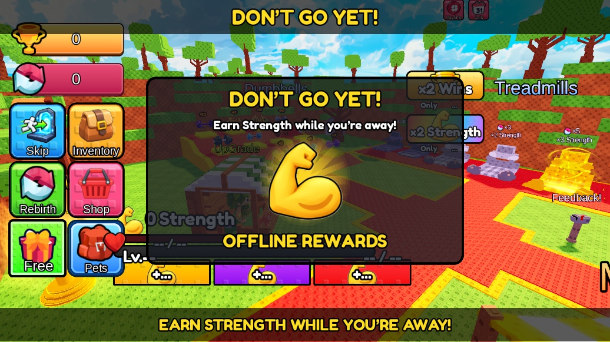
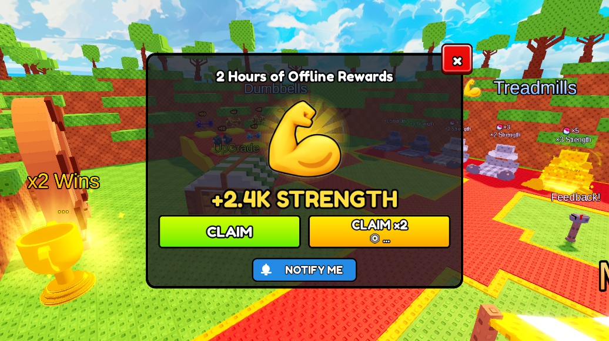

# オフライン報酬：通知ボタンとRobloxメニュー背後の案内

開始2026-11-19、完了確認2026-11-20 JST。Y01 / DESKTOP-CNFVEH2、既存副本 **PlaceId 126576845524886 / UniverseId 10765181857** の未保存Editへ反映。作業フォルダーは `C:\Users\kouji\Smash_and_Crush\AnalyticsSpawnItems`。開始HEADとfetch済みmainは `0c8033f24736d4e61361a36e660403a4e4ae440d`。

今回の最新指示に従い、前工程の「UIを追加せず接続待ち」を、**オフライン報酬のUIだけ**更新した。友達招待・紹介報酬・Premiumイベントは変更していない。Studio内の現在のPremium設定（2026-11-28 / 03:00）もそのまま保持。

## 実装した内容

- 通常の受取画面だけに、青い角丸の白ベル＋`NOTIFY ME`を追加。CLAIM / CLAIM ×2の下に独立した行を置く。既存の腕・黄色い光・FredokaOne・黒い枠・受取/価格/閉じる操作を維持。
- 画面表示時にローカルの `CanPromptOptInAsync()` をpcallで確認。trueの場合だけボタンを表示。クリックで再確認してから `PromptOptIn()` を呼ぶ。画面表示だけでは許可画面を開かない。false/エラーでは行を隠して元の高さへ戻す。
- 遅れた応答を世代で破棄。閉じた画面を再表示しない。確認中・ネイティブ画面表示中の連打を抑止し、GUI再生成時もネイティブ画面が閉じるまで共有ロックを保持。閉じたイベントは許可成功ではなく、能力の再確認にだけ使う。
- `GuiService.MenuOpened` / `MenuClosed` と初期 `MenuIsOpen` から、中央案内＋上下帯を**同じScreenGuiのEnabledで同時表示/非表示**。中央は指定の見出し・補足・腕・OFFLINE REWARDSだけ。通知/受取/購入ボタン、報酬額、LocalScript複製はない。
- 案内はすべて非操作部品。通常受取画面のVisibleや未受取状態を変更しない。CoreGuiや標準メニューには触れず、ゲーム内HUDの上のレイヤー60を使用。上下背景は全画面、文字はDeviceSafeInsets内。毎フレーム処理は追加せず、開閉・可視状態・画面サイズのイベントで更新。
- **通知予約・送信は前工程の実装を再利用**。新しい送信ループ、Remote、保存経路、報酬加算は追加していない。今回の許可UIは文面IDの有無と独立している。

## 変更Full Path

| Full Path | 変更 |
|---|---|
| `ReplicatedStorage.Config.OfflineRewardUIConfig` | 新規。案内と通知ボタンのサイズ・色・余白・ON/OFF |
| `ReplicatedStorage.Modules.OfflineRewardPresentation` | 新規。既存受取画面の追加行と、表示専用案内の生成/レイアウト。既存生成済みGUIにも設定を再適用 |
| `ReplicatedStorage.Modules.OfflineRewardNoticeClient` | 新規。メニュー同期、通知許可確認、非同期世代・多重起動抑止、終了時解除 |
| `ReplicatedStorage.Modules.StrengthHUDPresentation` | Offlineのレイアウト1箇所だけを上記共通処理へ委譲 |
| `StarterGui.StrengthGui.StrengthRewardClient` | MountとDestroy登録の2行だけ追加。View/Claim/購入/価格取得/Receipt連携は変更なし |
| `StarterGui.StrengthGui.OfflineRewards.NotifyRow` | 新規。Button/白ベル/文字を含む。Edit初期Visible=false |
| `StarterGui.OfflineExitNotice` | 新規。Center/TopBand/BottomBand。Edit初期Enabled=false、ResetOnSpawn=false |

5 Sourceはローカル内容とStudio Source・取得可能なエディター内容が一致し、構文確認済み。[SHA256](source_manifest.json)。開始時の6関連Sourceは[変更前全文/GUI値](before/)と[保全ハッシュ](before/manifest.json)へ保存。SourceはUTF-8で改行・末尾空白を保持。取得可能なエディターはSourceと同一だった。既存StrengthRewardClientのEnabled=trueを保持。

既存ローカル2ファイルはCRLF、StudioとGit blobはLFのため、変更後manifestはローカル生ファイル/Studio Source/Git blobのSHA256を分けて記録した。Git blobとStudioはバイト一致。変更前保全の6 Sourceは元のStudio bytesとハッシュ一致し、専用.gitattributesで将来のチェックアウト時の改行変換も抑止する。

新規GUIはコードから再構築できる。今回のSourceを個別配置した環境で、通常起動時に既存RewardUI.Build後のMountが不足分を生成する。Editで必要なら `OfflineRewardPresentation.EnsureNotify(StarterGui.StrengthGui.OfflineRewards)` と `EnsureExit(StarterGui, StarterGui.StrengthGui.OfflineRewards)` を使用する。受取LocalScriptを案内へコピーしない。

## 手動調整・停止方法

UIは `ReplicatedStorage.Config.OfflineRewardUIConfig`。数値は原則デザインpxで、画面へ収まる倍率を適用する。

| 設定 | 初期値 / 意味 |
|---|---|
| `Exit.Enabled` | true。falseで中央案内と上下帯を停止 |
| `Exit.Width / Height` | 700 / 410。中央案内の基準サイズ |
| `Exit.BandHeightScale / BandMinHeight / BandMaxHeight` | 0.10 / 44 / 90。帯の画面高比率とpx制限 |
| `Exit.BandTransparency / BandColor` | 0.35 / 黒 |
| `Exit.TopTextSize / BottomTextSize` | 52 / 40。最大文字サイズ |
| `Exit.TextColor / StrokeColor / Stroke` | 黄(255,221,35) / 黒 / 3px |
| `Exit.Title / Subtitle / Icon / Halo / Caption` | 中央の各部品 `{x,y,width,height}`。各文字サイズも同じ表内 |
| `Exit.SafeMargin / CenterMargin` | 12 / 18px。セーフエリア内側と中央の余白 |
| `Exit.DisplayOrder` | 60。ゲームGUI間の順番。CoreGuiを変更しない |
| `Notify.Enabled` | true。falseで許可ボタンの行を停止。サーバー送信設定とは別 |
| `Notify.Width / Height / MinTapPixels` | 230 / 48 / 44。最後の値だけ画面上の最小ヒット高さ |
| `Notify.Gap / BottomPadding` | 8 / 12px。基準450pxの受取画面の下に行を追加 |
| `Notify.Color / TextColor / TextSize / Radius` | 青(35,139,230) / 白 / 27 / 9px |
| `Notify.CooldownSeconds` | 2秒。ネイティブ画面が開いている間は時間だけで再開しない |

例：帯を薄くするには `Exit.BandTransparency = 0.5`。通知ボタンを少し広くするには `Notify.Width = 250`。非表示の行を残す固定高さは使わず、ボタンの表示可否と画面高から必要な高さを求める。

Configはクライアント起動時に読み込む。変更は次のセッションに反映され、既存の生成済みGUIにも再適用される。Studioで値を変えただけで既に動いているクライアントへホットリロードする仕様ではない。報酬全体の既存スタイルは引き続き `ReplicatedStorage.Config.StrengthHUDStyle.Offline`。

## 通知の設定と接続状態

**通知文面IDは未設定、実送信は無効。** 入力欄は `ReplicatedStorage.Config.EngagementConfig.Offline.OfflineRewardMessageId = ""`。確認できたIDがないため仮IDは登録していない。文字列として扱い、数値化しない。

同Configの既存値：`Offline.Enabled=true`、`DelaySeconds=86400`、`SecretName="OfflineRewardNotificationKey"`。`Worker.IntervalSeconds=60`、`MaxBatch=5`、`LeaseSeconds=120`、`MaxAttempts=3`、`RetryBaseSeconds=300`、`MaxBackoffSeconds=3600`、`BudgetReserve=40`。送信停止は `Offline.Enabled=false`。報酬蓄積上限とは別の設定。設定変更は次のサーバー起動から反映する。

既存の `OfflineNotificationService / Worker / State`、`PlayerDataService`、`PlayerDataOwnership`、`PlayerDataController` を読み取り照合し、今回変更していない。正常な退出保存と同じトランザクションの記録から、保存確定時刻＋DelaySecondsで予約する。再参加時はプロフィール所有権取得と同じUpdateAsyncで前世代を取消。参加時の復旧候補と期限索引、担当/個別リース、送信直前の世代・Presence・正の報酬条件確認を利用する。

既存HTTPはtrueを保持。送信はサーバーの `HttpService:RequestAsync()`、`POST https://apis.roblox.com/cloud/v2/users/{UserId}/notifications`、`source.universe="universes/10765181857"`、`payload.message_id`と`type="MOMENT"`。`GetSecret("OfflineRewardNotificationKey")`のSecretオブジェクトをx-api-keyへ渡す。今回Secretの値取得・ログ出力・再登録・本番API呼出しは行っていない。StudioはIDを設定しても本物の通知用保存/送信を行わない。

通知ボタンからは能力確認/許可画面だけを呼ぶ。送信・報酬・購入・保存・予約Remoteは呼ばず、架空の許可済み属性も作らない。通知許可はCLAIMの条件ではない。通知先/送信時刻をクライアントが指定するRemoteはない。

制約は[前工程の設計記録](../OfflineNotificationsFriendInvite_20261119/REPORT.md)を継承する。全サーバー停止中は送れず、再稼働後の処理まで遅延。24時間ちょうどや必達・厳密なexactly-onceを保証しない。API成功は受付成功であり端末への表示確認ではない。送信中の再参加取消は既に送出したHTTPを取り消せない。応答消失/成功記録保存失敗などの結果不明は無条件再送せず、重複抑止を優先する。参加/退出両方の索引登録が全試行失敗した場合は通知欠落が残り得る。プロフィール全件走査で補う処理はない。

## 検証区分

### 実際のEdit描画・静的確認

指定のDownloads直下の2枚を開いてから実装。参照スクリーンショットをGUI画像へ貼っていない。実Sourceの構文、Source/Editor一致、既存547 Sourceの対象外ハッシュ、既存126 GUI部品/プロパティ、既存ScreenGuiのEnabled復元を照合。最終Source数550（追加3 Module）、退出GUI1個。受取部分の元のプロパティに差分なし。

PC / iPhone 17 Pro横画面 / iPad Pro M5 13in相当で、実GUI部品をEdit上に描画。文字欠け、中央/帯の重なり、受取ボタンと通知行の分離を確認。スマホの通知ボタンは実GUI寸法約141.43×44.27px。PCとタブレットは230×48px。

下の画像は**Editの表示fixture**。通知許可可能を模擬し、報酬はサンプル「2 Hours / +2.4K」、価格は未取得の`...`。実Playerの報酬や価格ではない。切り分け用の6画像では他のScreenGuiを一時的に隠し、最終画像では既存HUDを戻して確認した。Enabledは全て復元。標準メニューを呼んだ画像ではない。

| サイズ | 通常受取UI | 中央＋上下帯 |
|---|---|---|
| PC | [画像](images/pc_reward.jpg) | [画像](images/pc_exit.jpg) |
| 横画面スマホ | [画像](images/phone_reward.jpg) | [画像](images/phone_exit.jpg) |
| タブレット | [画像](images/tablet_reward.jpg) | [画像](images/tablet_exit.jpg) |

### 隔離した模擬検証

[結果JSON](verification.json)、[UIテスト](../../tests/OfflineRewardUI.spec.luau)、[生成スクリプト](../../tests/OfflineRewardUIOffline.py)。時計・メニュー・通知能力/許可画面・保存・HTTPを差し替え、既存SourceとネイティブInstanceを実行した。

- UI **263 assertions**：許可可能/不可/APIエラー/クリック再確認/Prompt失敗/連打/閉じてからの遅延応答/GUI再生成中のnative lock/初期MenuIsOpen/30回開閉/通常画面の維持/入力非捕捉/イベント後始末/各画面レイアウト/44pxヒット高さ/設定再適用/UTF-8文言。
- 通知状態 **155**、APIアダプター **176**、既存Save関数への連携 **63**：正常退出と確定時計、期限前/一致/後、再参加・別サーバー・再退出、保存/索引失敗、処理権競合・停止/復旧、報酬0・未設定/OFF、HTTP無効・Secret不可・401/403/429、タイムアウト・結果不明・成功記録保存失敗。すべてメモリ上の保存先と偽HTTP。
- 既存報酬 **60**、所有権 **11**：通常受取、固定された2倍見積り、遅延/重複Receipt防止、再試行、所有権フェンスの回帰。合計 **728 assertions**。件数は実購入・実配信の証拠ではない。

受取クライアントの既存処理は追加2行を除いて一致。StrengthRewardConfig、StrengthRewardState、商品ID/Receipt/保存/通知Worker/イベント/招待Sourceは今回変更なし。退出案内の処理には報酬・購入・保存API参照がない。

### 未確認・実Playを行わなかった理由

`ServerScriptService.Config.DataStoreConfig` はStudioで名前に`_Studio`を付けるだけで、実DataStoreからの隔離保証ではない。現在の本体Play全体について安全な隔離を確認できず、新規Place作成や多数サービスの差し替えも行わないため、**Play/Stopは実行していない**。

そのため、実ネイティブRobloxメニューとの重なり/標準操作、実タップによる許可画面・取消、実Playerでの受取/購入/Receipt、死亡復帰の実Play、実機の画面/性能、本番DataStore/Secret/通知許可/実配信は未確認。PC/スマホ相当のEdit描画とイベント模擬を実機・実Play合格と扱わない。通常受取画面と他HUDの実Play併存・ヒット操作も残る。

実際のEditで既存HUDを全て出した受取fixtureでは、既存の右側パスバナーが受取枠の右上へ重なった。既存StrengthGuiの表示順10とパスGUIの25は変更していない。今回追加した退出案内は60で前に描画するが、通常受取画面全体の既存HUDとの表示順/実Playレイアウトは別途実操作確認が必要。6枚の切り分け画像だけを根拠に、HUD併存時も問題なしとは判断していない。

## 公開前後に人が行う最小限の確認

1. 安全なデータ隔離を確認したPlayで、通常報酬のCLAIM/CLAIM ×2/閉じる、通知ボタンの実許可画面と取消を確認。通知許可不可でも受取可能であることを確認。
2. Robloxメニュー開閉で中央と上下帯が同時に出入りし、標準の退出/再開/設定を邪魔せず、通常報酬の状態が保持されることを実操作で確認。横画面スマホでも行う。
3. 配信を有効にする段階で上記設定欄へ正しい通知文面IDを文字列で入力。ユーザー自身のSave/Publish後、同意した検証用アカウントの正常退出・期限到来・再参加取消を確認。API受付と実受信は区別する。今回の作業ではこれらを実行していない。

検証用GUI複製は除去済み。元の端末シミュレーター（generic_handheld_720、1280×720、LandscapeLeft、FitToWindow、DPI182.66667）へ復帰。元の未保存編集を保持したEditでStudioを開いたまま。Save/Publish・実通知・実購入・招待・Creator Hub操作なし。別worktree/stash/crashes/を操作せず、今回のSource・テスト・報告・関連SPECだけを通常commit/pushする。

## 公式API参照

- [ExperienceNotificationService](https://create.roblox.com/docs/reference/engine/classes/ExperienceNotificationService)：能力確認とOptInPromptClosedの意味。
- [GuiService](https://create.roblox.com/docs/reference/engine/classes/GuiService)：MenuOpened/Closed/IsOpen、GetInsetArea。
- [ScreenGui](https://create.roblox.com/docs/reference/engine/classes/ScreenGui)：ScreenInsetsと表示順。
- [Experience notifications](https://create.roblox.com/docs/cloud/guides/experience-notifications)：送信・受付と配信条件。
