# Ore merge five-slot input strip — 2026-11-12

## Outcome and scope

Implemented in the currently open unsaved canonical Studio, PlaceId **126576845524886**. Fetched origin before work: local main and origin/main both pointed to **8df29f8**. The focused live Sources/editor buffers matched their Git mirrors. Current Studio edits remained authoritative; no Git-to-place restoration occurred.

Opened and visually inspected the requested reference before implementation: `C:\Users\kouji\Downloads\鉱石タブの5スロット合成画面.png`. The dark rounded empty slots, quiet remaining slots and next-slot plus informed the implementation. Reference Ore identities/counts were not copied into production state.

**Only one production Full Path changed:** `ReplicatedStorage.Modules.MergeShopView` ([Source](../src/ReplicatedStorage/Modules/MergeShopView.luau)). The controller, OreMerge rules, Forge client/service/persistence, analytics definitions and tutorial Sources were not edited.

## Behavior

The existing `oreSelected` quantities and `selectedEntries()` unit expansion remain the sole selection authority. Existing input cards are reused. Five reusable noninteractive empty-slot Frames fill the remaining positions; there is no second quantity table, selected-empty-slot state or extra confirmation.

- 0 units: five empties; the first slot is highlighted when loaded and not pending.
- 1 unit: one real existing Ore card; only the second slot is highlighted.
- 2–4 units: real cards plus quiet empties. No further slot is highlighted as mandatory. Existing OreMerge.Evaluate and pending checks decide Merge availability.
- 5 units: five real cards. Existing availability rejects the sixth.
- Repeated Ore IDs occupy separate slots. Removing an input decrements the original quantity by one; display is compacted in the existing material order.
- Clear, material selection counts, total points, candidates/probabilities, existing per-card Ore image/rarity and drag input are retained.
- Only Ore merge uses a non-scrolling input strip. Its obsolete “Drag Ores Here” label is hidden so it cannot cover slots. Item/Pet and Ore sale retain their existing paths.
- Pending/loading states do not highlight required additions. Ore Merge availability now also requires `oreState.Loaded==true`, preventing stale non-loaded ownership from appearing executable. Sale readiness and server conditions were not changed.
- Empty decoration has Active=false and Interactable=false. No animation, Tween, extra input listener or frame loop was added. Hide clears slot visibility/highlight; the existing view lifecycle destroys them.

The yellow Merge header, close button, tabs, material list, result pane, drop region, Total, Selected, Clear and Merge remain the existing layout.

## Scoped defect found during required gesture verification

A synthetic touch-scroll sequence reproduced an existing type error in MovePointer. PressMaterial stored a Vector2 in `drag.Start` and a timestamp in `drag.Started`; the scroll time check incorrectly evaluated `os.clock()-drag.Start`.

Changed only that reference to `drag.Started` ([line 362](../src/ReplicatedStorage/Modules/MergeShopView.luau#L362)). The 10-pixel threshold, 0.2-second window, vertical-direction test, drag behavior and existing activation suppression remain unchanged. This shared gesture fix also prevents the same exception in other material tabs; it does not change their merge rules or layouts.

## Manual appearance settings

Ore-only settings are together in `oreSlotStyle` ([line 16](../src/ReplicatedStorage/Modules/MergeShopView.luau#L16)):

| Setting | Value |
| --- | --- |
| Accent | **Color3.fromRGB(91,159,230), #5B9FE6** |
| Quiet border / plus | 100,100,100 |
| Background | 26,28,29, transparency 0.12 |
| Corner / outline / gap | 16 / 6 / 16 design pixels |

Accent is declared once and used by the new highlighted slot border and plus. The existing shared cyan, Item/Pet colors, selected material-card border and drop-area dashes were not globally replaced. Placeholder construction includes its subtle gradient and plus layout ([line 124](../src/ReplicatedStorage/Modules/MergeShopView.luau#L124)). The five-column geometry is at [line 577](../src/ReplicatedStorage/Modules/MergeShopView.luau#L577).

## Verification performed

All tests used current Source copies and isolated state. They made no production Forge, purchase, analytics or save requests.

| Test | Result and scope |
| --- | --- |
| [OreSlotsBehaviorEdit](../tests/OreSlotsBehaviorEdit.luau) | **234 assertions**: 0/1/2/3/4/5, sixth rejection, repeated/mixed Ore, removal, Clear, owned cap, single activation, vertical scroll suppression, drag/activation in both callback orders, pending duplicate prevention, synthetic success/failure, inventory reduction, loading/save-pending state, open/close/tab/sale transitions. |
| [OreSlotsIntegrationEdit](../tests/OreSlotsIntegrationEdit.luau) | **20 assertions** using exact existing tutorial and analytics Sources with isolated player/clock/transport. Initial guide goes to Merge at two valid units; higher guide retains its points threshold; sale and pending steps remain. Existing analytics selected quantities, duplicate suppression, finished-session and existing-player exclusion remain. Five synthetic transmissions were observed; none were sent to Roblox. |
| [OreSlotsRegressionEdit](../tests/OreSlotsRegressionEdit.luau) | **5,736 assertions across 788 compared GUI objects**: current versus pre-task visible geometry/art/text/input state for Item and Pet empty/selected/request-return paths and Ore sale. Pet tile/request boundaries were mocked; no live Pet merge/hatch was performed. |
| [OreSlotsGeometryEdit](../tests/OreSlotsGeometryEdit.luau) | **384 native Edit assertions** across four presets x four states. Five slots remain visible and separated, Total/Clear/Merge fit without overlap, occupied paint/hit rectangles agree, empty decoration is noninteractive and readiness matches the valid fixture selection. |

Reproduction fixture: [OreSlotsPreviewEdit](../tests/OreSlotsPreviewEdit.luau). Run it only in an isolated Edit verification context; it refuses an existing MergeShopGui, clones the current donor, substitutes Forge/analytics/player boundaries, and exposes synthetic callbacks. The regression function accepts the pre-task Source from commit 8df29f8 solely to construct a comparison fixture. It must never be assigned over production Studio Source. Cleanup is `_G.OreSlotsReview.Stop()`; reset the device simulator afterward. All those helpers were already removed from the delivered Studio.

The first behavior run exposed the real drag timestamp defect above and failed until the one-word correction. The first old/new regression compared hidden cached sale labels from different UI histories; the comparison was corrected to compare visible presentation. These initial failures are not passing evidence.

Final scoped audit: 15 Sources compile and match editor buffers/reviewed candidates. Unchanged sources include OreMerge, MergePanelClient_New, both Ore tutorial modules, ForgeClient, FirstPlayAnalyticsClient, the previous Trophy/Egg/badge changes, HUDLayout and TouchControlZoneClient. StarterGui.ScreenOrientation remains LandscapeSensor, and HUDLayout retains its 0.70 relative floor.

## Rendered comparison images

The following **actual Studio Device Simulator Edit captures** are retained at the user's explicit request, overriding the repository's usual temporary-screenshot rule. No generated mockup or edited/composited substitute is used. Native current Merge GUI and current asset/config definitions are rendered against a neutral verification backdrop. Owned counts are isolated fixture data, not production player inventory and not fixed in implementation.

| Preset | Observed safe GUI viewport | Slot side | Existing Clear / Merge height |
| --- | --- | ---: | ---: |
| iPhone 7, small landscape | 667 x 375 | 49.14 px | 25.74 / 31.98 px |
| iPhone 16 Pro Max, large landscape | 832 x 440 (preset/capture 956 x 440) | 58.24 px | 30.51 / 37.90 px |
| iPad Pro M5 13-inch | 1376 x 1032 | 124.16 px | 65.04 / 80.80 px |
| Average Windows | 1366 x 768 | 104.16 px | 54.56 / 67.79 px |

Five slots, total points, Clear and Merge fit in every inspected image. The existing smaller phone footer buttons were retained; physical tap comfort was not established by these dimensions.

| Device | 0 units | 1 unit | 2 units | 5 units |
| --- | --- | --- | --- | --- |
| Small phone | 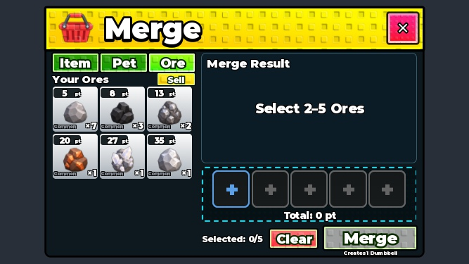 | 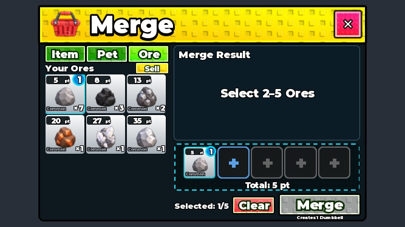 | 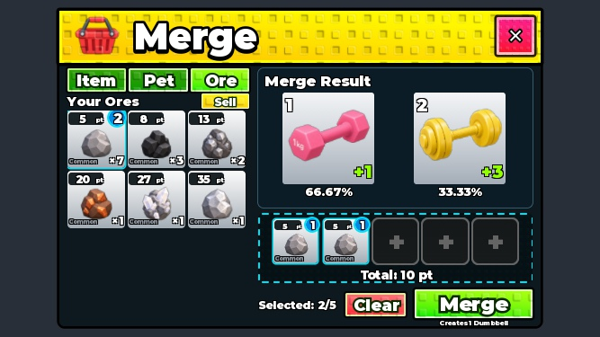 | 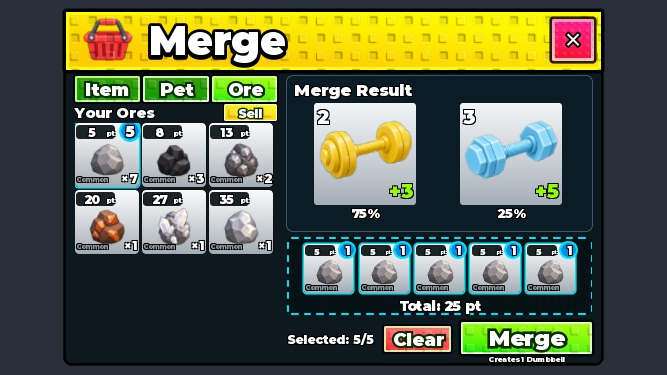 |
| Large phone | 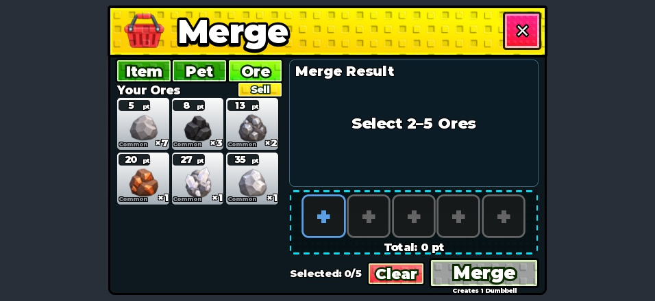 | 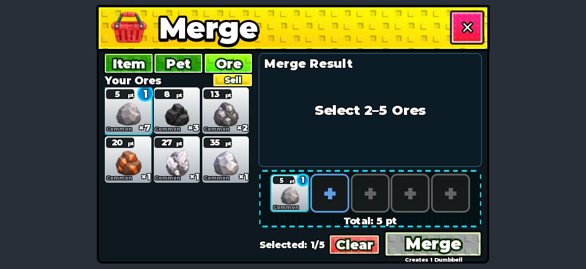 | 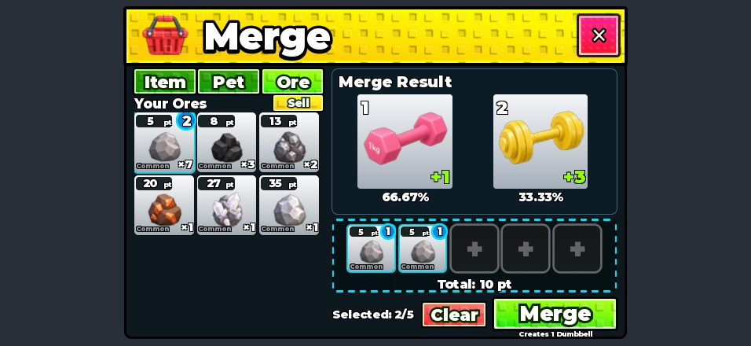 | 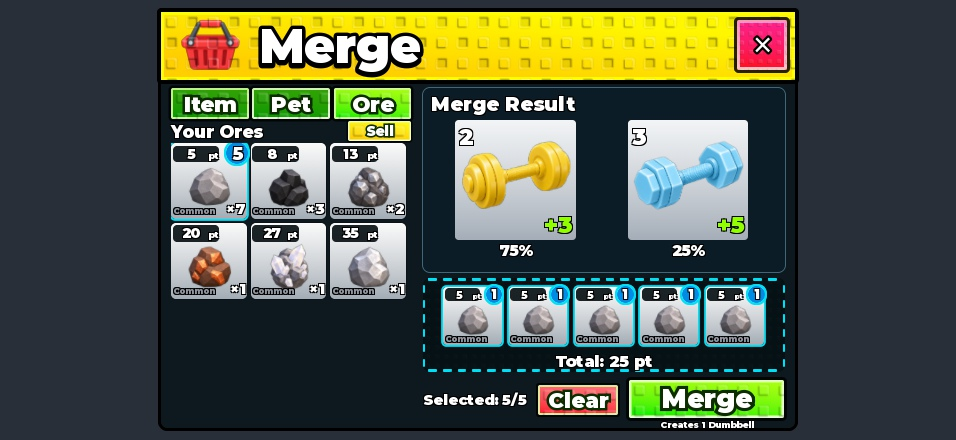 |
| Tablet | 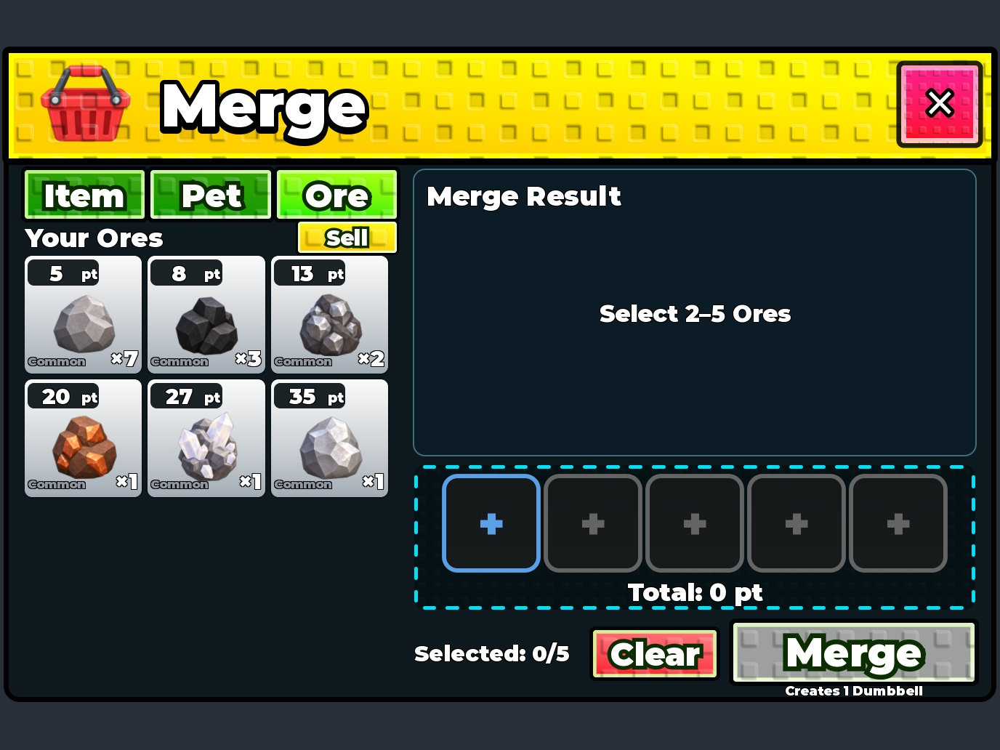 | 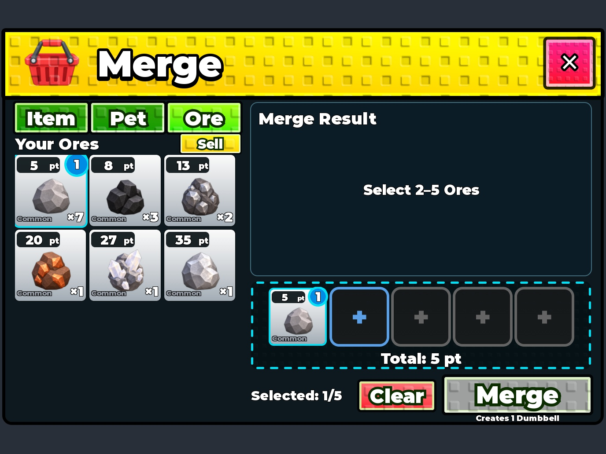 | 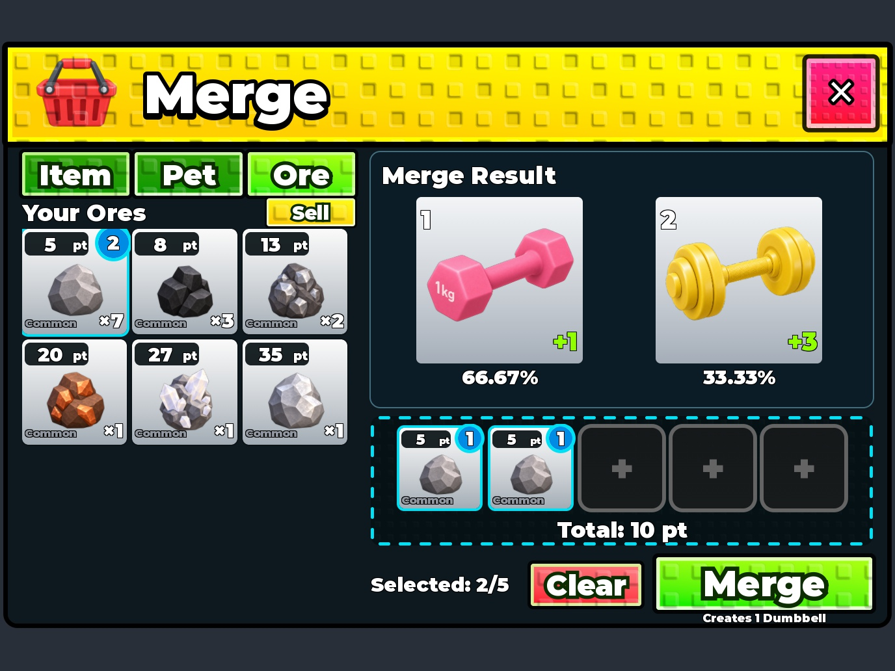 | 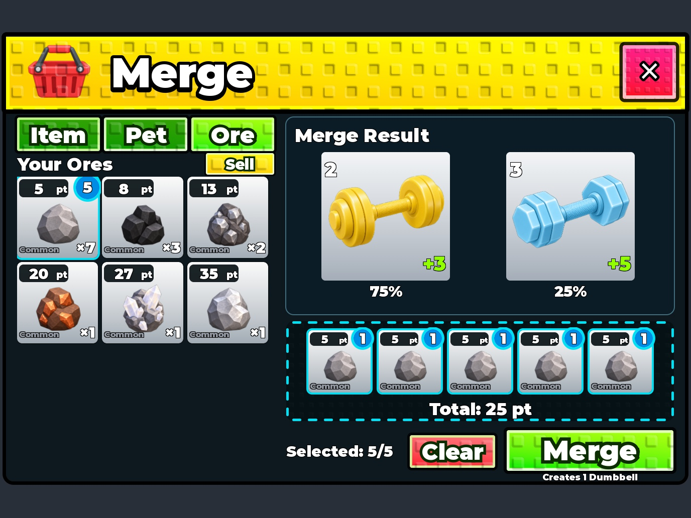 |
| PC | 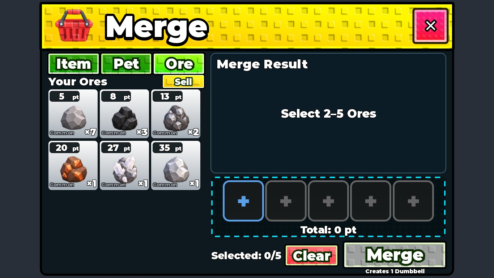 | 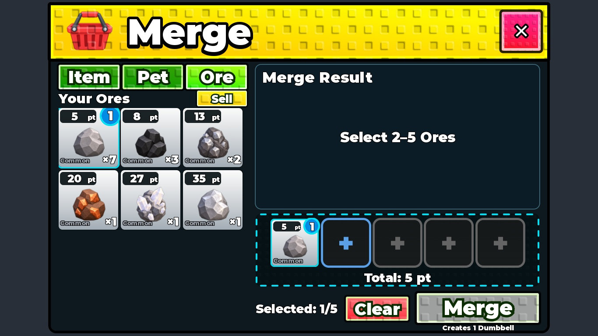 | 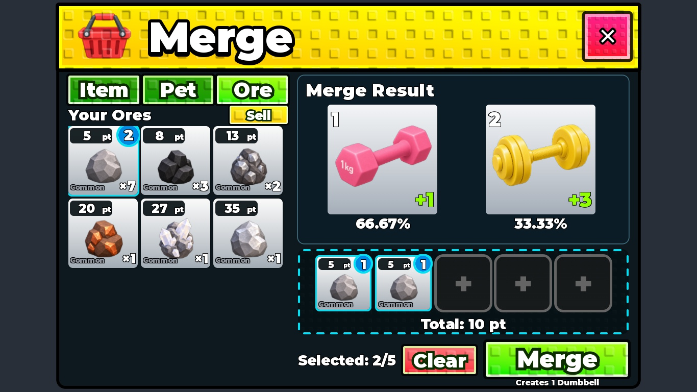 | 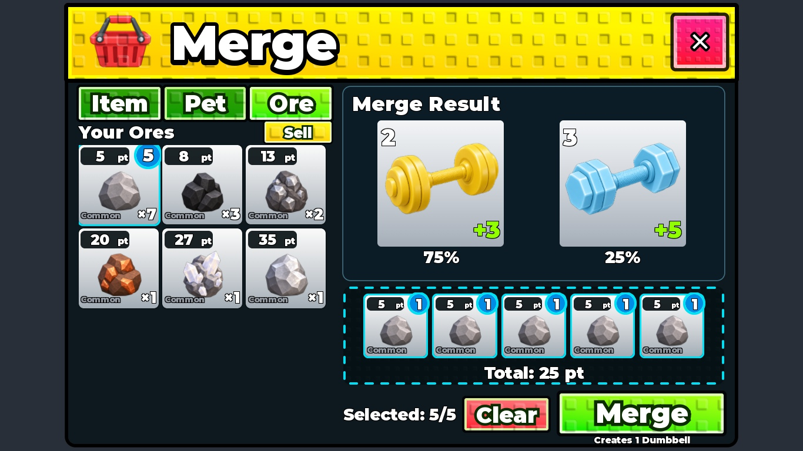 |

The first capture request stalled while the camera viewport remained at the previous dimensions. That waiting capture call was cancelled (not Studio/Play), and the issue was reported. Subsequent viewport updates/captures succeeded; only the successful inspected captures are included.

## Verification boundaries

- **Performed:** native Edit GUI rendering, native geometry, exact presentation/callback logic with synthetic gestures and state, old/new unaffected-tab comparison, exact tutorial/analytics logic against isolated dependencies.
- **Not performed:** physical touchscreen/mouse clicks, actual gameplay Play, real inventory merge/sale, durable save/retry, real network/analytics ingestion, live Pet hatch, actual device/tutorial-hand raster interaction or live app navigation.
- Tutorial target decisions were verified with a stub renderer: the real tutorial hand/arrow was not shown in these screenshots. The new emphasis is static, becomes quiet at two units and never captures input; existing presentation Source was preserved.
- These screenshots establish the inspected Edit appearance, not a claim of physical-device or production transaction acceptance.

## Cleanup and delivery

Removed the preview, regression and tutorial fixtures, events and globals. Restored StarterGui.ShowDevelopmentGui and the default simulator viewport/orientation. Studio remains in Edit. No user Play was started/stopped, no OS mouse/keyboard or window-activation/UI Automation action was used, and no Save/Publish, saving GUI operation, Place-file write or Studio shutdown occurred.

Only this Source change, focused tests, requested comparison images and task documentation are included in the normal origin/main commit/push. Existing unrelated untracked work is excluded; PR #1 remains unmerged by this task. **Canonical Studio is unsaved. Manual Save, and Publish when ready for players, are still required.**
