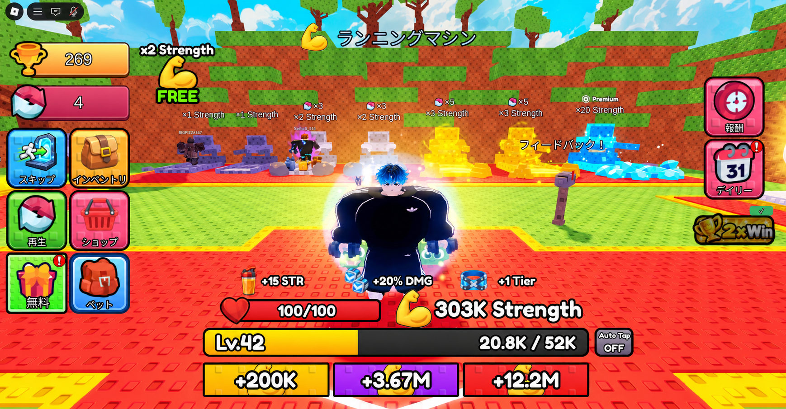
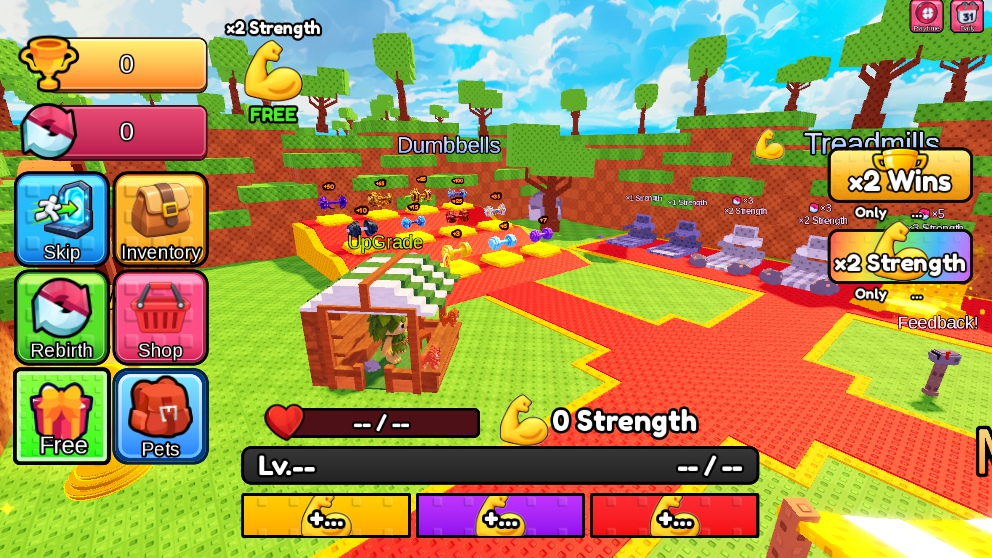
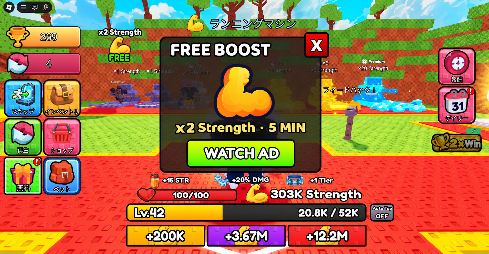
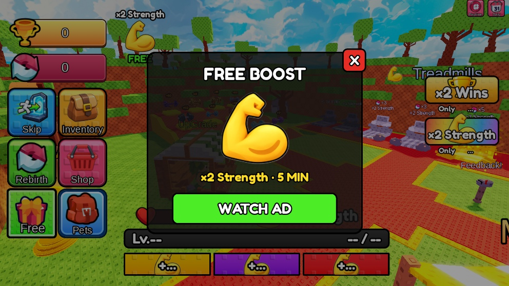
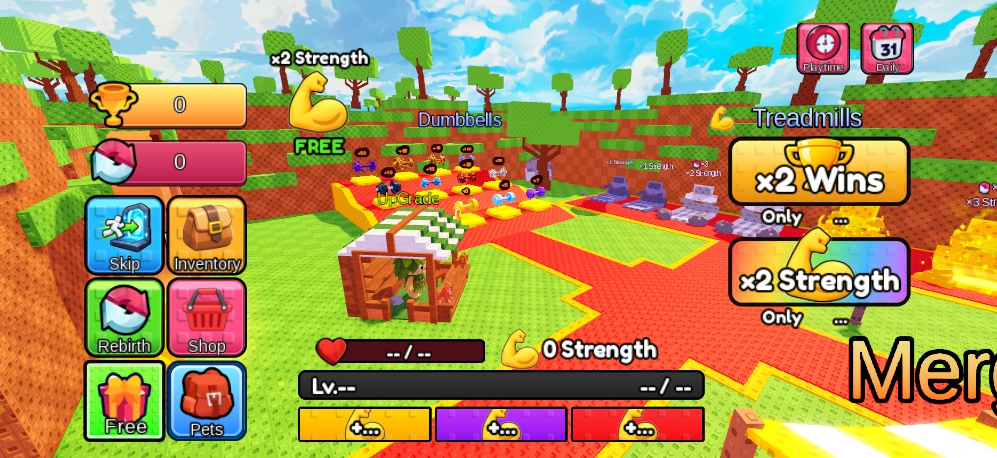
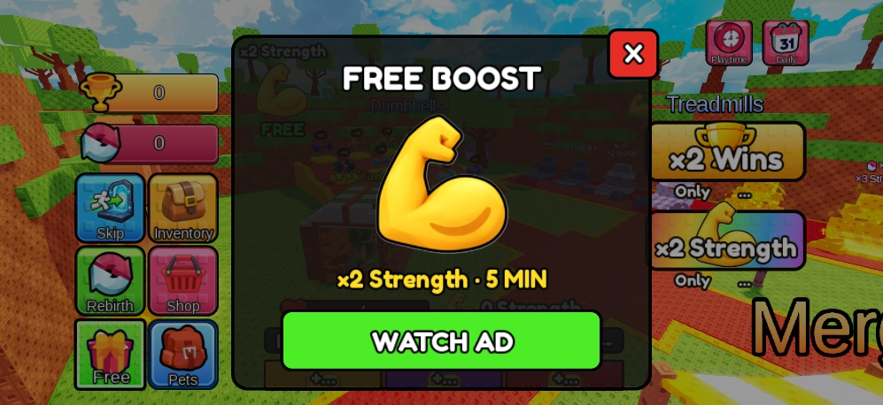
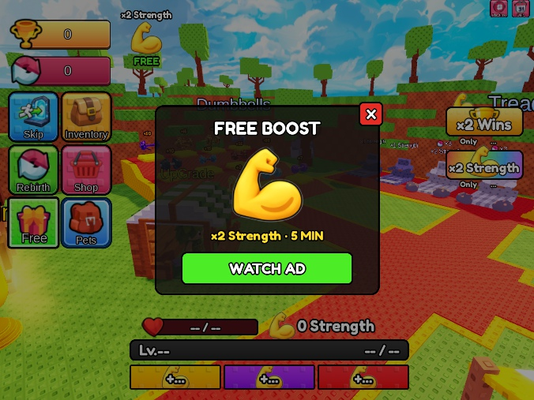
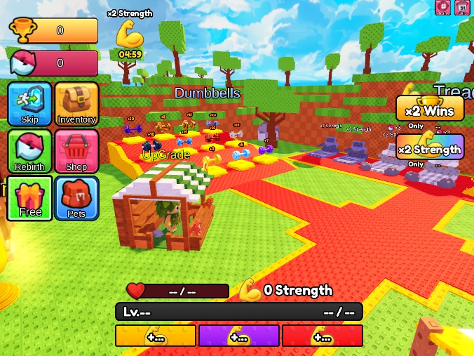
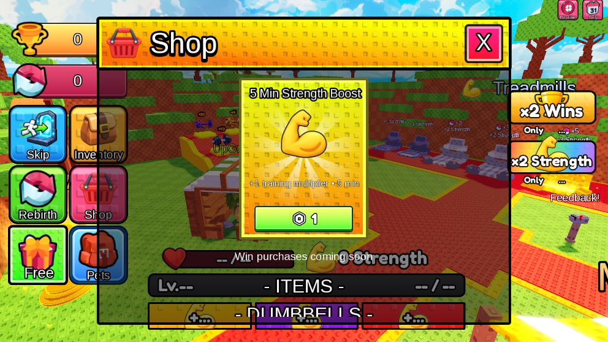

# Rewarded video: 5 Min Strength Boost — 2026-11-20

副本 `126576845524886` / Universe `10765181857`、Y01 (`DESKTOP-CNFVEH2`) の既存Editへ反映。開始時main/HEADは `c43b1c27198e7d33fab99eb0a365934dcb7bc486`。作業場所は `C:\Users\kouji\Smash_and_Crush\AnalyticsSpawnItems`。既存の未保存編集を基準とし、Play/Stop、Save/Publish、実広告、実購入、実通知、実Player/DataStoreアクセスは実施していない。

## 実装と公開前の残作業

- 広告Placement **28777229838999**、Developer Product **3733706770**、永久Strengthパス **2089895831** を分離。
- 商品の効果は **300秒、訓練の加算倍率へ＋1**。永久パス＋1、Belt/Training Potionと同じ加算段へ一度だけ入り、既存の装備・Rebirth・Strength Potion・VIP・Petの順序は保持。直接報酬、オフライン/デイリー、購入Strengthの計算は変更しない。
- 両Worldの歩行/手動タップ/既存AutoTap/Treadmillに適用。既存の占有・共有クールダウン・受取/receipt経路を共用。
- 広告の完了結果は表示状態だけに使用。報酬は既存の唯一の `ReceiptService.ProcessReceipt` から正規receiptを処理したときだけ確定。
- 通常ショップへ同じ商品を追加。WATCH ADは広告専用でRobux購入を呼ばない。
- **Creator Hub側の商品名と説明は未変更**。読み取りAPI・Marketplaceの両方で現在 `24h Strength Boost` と取得した。`developer-product:write` がMCPに未許可で、権限確認は拒否された。回避・別商品作成・価格変更はしていない。公開前に同商品の名前・説明を **5 Min Strength Boost** へ修正する必要がある。
- 取得価格は **1 Robux**、販売中。Open Cloudの基準価格・Marketplaceの今回の取得値が一致。RegionalPricing・ManagedPricingは維持。通常購入UIはプレイヤーのMarketplace API実値を表示し、1を固定値やフォールバック価格として登録していない。

実装反映済みと、実広告配信・公開検証済みは別。Creator Hubの広告有効化、配置の実配信資格/在庫、実receipt配送は未確認。

## 変更Full Path

| Full Path | 内容 |
|---|---|
| `ReplicatedStorage.Config.RewardedStrengthBoostConfig` | 商品・広告枠・時間・加算・起動制御 |
| `ReplicatedStorage.Config.RewardedStrengthBoostStyle` | 腕、フォント、位置、寸法、余白、色 |
| `ReplicatedStorage.Modules.RewardedStrengthBoostPresentation` | 入口/モーダル、既存Shopカードの構築・レイアウト |
| `ReplicatedStorage.Modules.RewardedStrengthBoostClient` | 可否確認、操作、タイマー、閉じる/再生成の後始末 |
| `StarterGui.StrengthGui.RewardedStrengthBoostClient` | 上記クライアントの単一Mount |
| `ServerScriptService.Services.RewardedStrengthBoostState` | 副作用のない終了時刻/receipt状態変換 |
| `ServerScriptService.Services.RewardedStrengthBoostPersistence` | 既存プロフィール所有権付き保存への統合 |
| `ServerScriptService.Services.RewardedStrengthBoostController` | 広告開始・正規receiptの検証、送信しない試験用依存境界 |
| `ServerScriptService.Services.RewardedStrengthBoostService` | AdService/Marketplace/PlayerDataの本番接続 |
| `ServerScriptService.Systems.Controllers.RewardedStrengthBoostBootstrap` | 一度だけ起動、Remote接続 |
| `ServerScriptService.Services.PlayerDataService` | `StrengthBoost`正規化、確定receipt操作、倍率取得、表示Attribute |
| `ServerScriptService.Services.StrengthManager` | 既存訓練用の加算箇所へ1行追加 |
| `ServerScriptService.Systems.Purchases.ReceiptService` | 指定ProductIdだけ既存振分けへ追加 |
| `ReplicatedStorage.Remotes.RewardedStrengthBoost` | 固定のAd/Buy操作。商品ID・時間・倍率・対象Playerは受け取らない |
| `StarterGui.RewardedStrengthBoostGui` | `Entry` / `Overlay.Panel`。Editの最終状態では両方非表示 |
| `StarterGui.StrengthGui.ShopPanel.MainScrollingFrame.Holder.StrengthBoostProduct` | 通常購入カード。既存CardWinを表示用に複製 |

既存Sourceの変更はPlayerDataService・StrengthManager・ReceiptServiceの3件だけ。開始時549 Sourceから新規10件を追加し559件。対象外Sourceのハッシュ保持、エディターバッファとの一致、Premiumイベント設定保持を最終照合する。StrengthManagerのStudio固有の末尾LFも保持。

変更前の3 Sourceは [before/manifest.json](before/manifest.json) とbefore配下へ保全。ローカルの改行を保持したバックアップであり、Studioバイナリ保存ではない。新GUIはコードから復元可能。通常起動時に自分自身のGUI/カードだけを一度再構築するため、Styleの変更は次のPlay/新サーバーで反映される。

## 設定・停止・戻し方

`ReplicatedStorage.Config.RewardedStrengthBoostConfig`:

| 設定 | 初期値 | 意味 |
|---|---:|---|
| Enabled | true | 新しい広告開始と通常購入入口の許可 |
| ProductId | 3733706770 | 既存のDeveloper Product |
| PlacementId | 28777229838999 | 報酬付き動画の広告枠 |
| ProductName | 5 Min Strength Boost | ゲーム内ショップ名。Creator Hubの名前は別途更新が必要 |
| DurationSeconds | 300 | 正規receipt1件につき加える実時間秒数 |
| TrainingBonus | 1 | 訓練元倍率への加算値 |
| RequestCooldownSeconds | 3 | サーバー側の起動要求間隔 |
| ClientResponseTimeoutSeconds | 120 | UI待機を解除する時間。サーバーでまだ広告呼出し中ならロックは維持 |

停止は `Enabled=false`。**既に確定した有料/広告報酬の残時間と後着の正規receiptは尊重する**。永久パスの所有権を変更せず、期限到達で一時＋1だけが自然終了する。Style/Configはセッションでrequireされるため次のPlay/新サーバーから反映。既存の保存済みExpiresAtを書き換えて5分へ戻さない。

`RewardedStrengthBoostStyle.Entry` は左HUDとの間隔・上端・幅/高さ・文字、`Modal` はパネル/腕/文字/緑ボタン/赤Xの寸法、共通色・透過・フォント・ArmImageを調整できる。腕は既存 `StrengthHUDStyle.Assets.Strength` (`rbxassetid://106106287008236`) を使用。閉じるXは小画面でも約45px以上を確保。入口は現在の左メニュー、表示中のバッグ/帰還UIを避ける。

戻す場合は今回commitの対象差分だけをレビューして戻す。`before`でStudio全体を上書きしない。receiptや保存済み終了時刻を削除すると再処理の整合性を壊すため、機能停止のために保存データを消去しない。

## 保存・二重付与防止

`PlayerData.StrengthBoost = {ExpiresAt, Receipts}`。同じプロフィールの1回の所有権付きUpdateAsyncで、終了時刻とPurchaseId処理済み記録を同時確定する。期限はUTC Unix秒、半開区間 `now < ExpiresAt`。死亡/World移動/再参加で初期化せず、退出中も経過する。

別の正当なreceiptは `max(now, ExpiresAt)+300`。同一receiptは再延長しない。`ProductPurchaseChannel`の正規Enumを `AdReward` / `InExperience` / `ExperienceDetailsPage` / `CommerceProduct` として記録。古いreceiptでチャネルが欠落していても商品報酬を捨てず `Unknown` として扱う。

保存の応答消失時は同じ操作を既存PendingItemMutationの保存バリア内へ残し、1/2/4/8秒の既存上限付き再試行を使用する。確認できなければNotProcessedYet。成功後に応答が消えても保存済みPurchaseIdを確認し、重複延長しない。プレイヤー不在・未ロード・所有権喪失・保存中もNotProcessedYet。再処理はRobloxの既存receipt再配送に従う。即時再配送や障害時の即時表示を保証しない。

UpdateAsyncのコールバックは新しいテーブルとメタデータを返すだけで、UI通知・広告・HTTPを行わない。所有権トークン/ResetTokenを検査。通常Saveは保存済みStrengthBoostを保持し、古いメモリ値で巻き戻さない。receiptマーカーは効果終了時に削除しない（長期購入履歴分のプロフィール容量は増える）。

増えるDataStore要求は**新規receiptの確定時のプロフィールUpdateAsync**と、失敗時の上記限定再試行。既にこのセッションで確定済みの同一receiptはメモリの耐久確認済みマーカーで返す。毎秒の保存・期限切れ保存・広告可否のDataStore照会・別の全件走査は追加していない。既存の通常保存・退出保存・所有権Acquireの頻度は変更しない。

## 広告・UIの制御

LocalScriptの可否APIを起動時、モーダルを開く時、WATCH AD、期限切れ、World/Character変化時に使用。常時の可否ポーリングはない。年齢/地域/端末を推測しない。クライアント表示は資格の根拠にせず、サーバーとAdServiceが実開始を判定する。

サーバーは既存のTrainingLobbyAreaService、IsFighting、生存状態、プロフィール、効果中、実行中ロック、連打間隔を確認。安全区域外はReturn to Lobby。転送/無敵/操作固定は追加しない。AdReward生成後にも確認。実行中のShow呼出しをUIの120秒待機終了だけで解放しない。結果失敗・退出後でも後着の正規receiptは独立に受け付ける。

入口は有効なブースト中なら広告可否にかかわらずタイマー表示。ローカルの同期済みサーバー時刻で計算し、Textが変わる秒だけ書換え。Remote照会・DataStore保存なし。通常受取/ショップ/インベントリ等やRobloxメニューが開けば新モーダルだけを閉じる。既存画面を勝手に開閉しない。ScreenGui DisplayOrder=50でゲーム内バナーより上、標準メニューより下。

Studioでは実広告・実購入開始を明示的に無効化。広告成功を偽装して付与する経路は置いていない。

## 検証結果

[生の結果](verification.json)。全件とも実Playとは区別する。

| 種別 | 結果・範囲 |
|---|---|
| Editメモリ・実Source関数 | Core 126項目。開始/299秒/300秒/期限後、別receipt、同一receipt、保存前失敗、保存後応答消失、同時処理、再参加/所有権喪失、遅延receipt、OFF/Studio、キャンセル/失敗/実行中ロック |
| Training統合模擬 | 363項目。現行TrainingManager/AutoTap/GamePass/StrengthManagerと実AddStrengthGain・LevelProgressionを通してメモリStrength更新。接地/占有だけはfixture入力であり実乗車ではない |
| Save統合模擬 | 75項目。現行PlayerDataService.Save。成功/失敗/応答消失、退出通知の既存フック、保存済みブーストが古いスナップショットで戻らないこと |
| 新UI模擬 | 62項目。nativeの未接続GUI、可否/失敗/連打/閉じた後の応答/タイムアウト/後着確定/再生成、通常購入との分離、旧クリック受け皿の排除、端末幅とバッグ回避 |
| 既存報酬回帰 | 71項目。通常/2倍オフライン、保存/receipt再試行、プロフィール所有権 |
| 既存通知・メニューUI回帰 | 263項目。既存NOTIFY MEとメニュー案内。許可画面はモック |
| Edit描画 | PC 1365×768、iPhone 17 Pro横画面の安全領域749×381、iPad Pro M5相当1375×1031。入口・モーダル・タイマー・通常Shopを画像確認 |
| 実Play/実機/実広告/実購入 | **未実施・未確認**。保存なしのPlay隔離を確認できず、Playへ進んでいない。`_Studio`保存先を安全な無保存環境と扱っていない |

合計960項目は模擬アサーション数であり、960件の実広告・実購入を意味しない。テスト時計・Player・所有権・購入ダイアログ・広告結果・DataStoreは依存差し替え。プロフィール/Secret/通知を使用しない。

### 訓練統合模擬の実際の値（他補正なし）

| 経路 | 永久パスなし | 永久パスあり |
|---|---:|---:|
| 歩行/AutoTap/手動 | 2 | 3 |
| World1 Normal (基本1) | 2 | 3 |
| World1 Premium (基本7) | 8 | 9 |
| World2 Normal (現行基本5) | 6 | 7 |
| World2 Premium (基本15) | 16 | 17 |

現行World2通常設備の基本5を1へ変更していない。装備・Belt/TrainingPotion/StrengthPotion/VIP/Pet/Rebirth併用、次の加算直前の期限切れ、Treadmill中の手動/AutoTap抑止も同じfixtureで確認した。実物上での歩行・接地・広告中の操作・再参加は未確認。

### 参照・比較画像

指定2枚をDownloads直下から実際に開いて内容確認。原本は移動/削除せず、ユーザー指定により報告用コピーを保持。[元パス・SHA256](references.json)。画像をUIへ丸貼りしていない。

| 参照 | 実装後（Edit描画） |
|---|---|
|  |  |
|  |  |

描画確認には既存HUDの一時複製と実レイアウトModuleを使用し、最後に複製・接続を除去。04:59は表示確認用でPlayer報酬ではない。小画面の入口は約101×99px、WATCH ADは約313×56px、Xは最終約45×45px。元の `generic_handheld_720 / 1280×720 / LandscapeLeft / FitToWindow` へ復帰。

## 公開前/公開後に人が確認する最小項目

1. 商品3733706770の名前・説明を5分へ修正（価格は現在値を保持）。本報告時点の24h表記のまま公開準備完了とはしない。
2. Creator Hubの既存広告枠・当該Experienceの広告資格/有効化を確認。設定を勝手に有効化・作り直していない。
3. ユーザーによるSave/Publish後、安全な検証用アカウント・環境で実広告の可否、WATCH AD→正規receipt→タイマー、実購入経路、300秒失効/再参加を確認する。実機の文字/入力/標準広告画面も未確認。

今回エージェントはSave/Publish・実広告操作・実課金をしていない。既存副本は未保存Editで開いたまま。Premiumイベント、新Strength表、オフライン通知文面IDと受取UIは対象外として保持。

## 公式APIを確認した資料

- [報酬付き動画広告](https://create.roblox.com/docs/production/promotion/rewarded-video-ads): 通常ゲーム内でRobux購入可能なDeveloper Productが報酬要件。安全区域での開始。
- [AdService](https://create.roblox.com/docs/reference/engine/classes/AdService): GetAdAvailabilityNowAsync / CreateAdRewardFromDevProductId / ShowRewardedVideoAdAsync。
- [MarketplaceService](https://create.roblox.com/docs/reference/engine/classes/MarketplaceService): 唯一のProcessReceipt、正規PurchaseId/PlayerId/ProductId/購入チャネル。
- [ProductPurchaseChannel](https://create.roblox.com/docs/reference/engine/enums/ProductPurchaseChannel): AdRewardと通常購入チャネルを区別。
- [Developer Products API](https://create.roblox.com/docs/cloud/reference/features/developer-products): creator読み取りと更新権限。現在値はverification.jsonに保存。

コミット/通常push後のSHAは最終返信で報告（自己参照SHAをこのファイルへ後付けする追加commitは作らない）。
