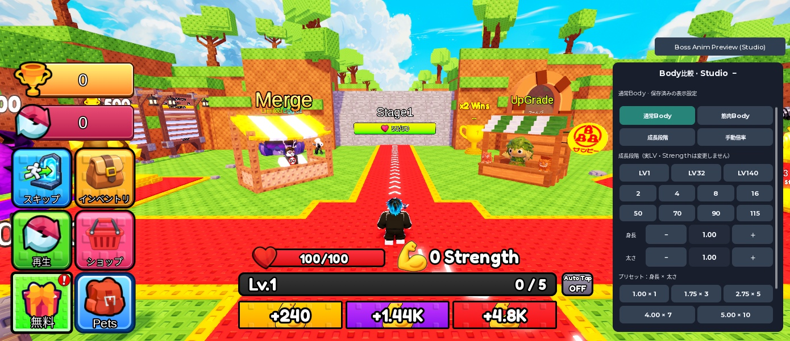

# World1 常設床矢印ガイド — 2026-11-16

指定の副本 **PlaceId 126576845524886 / UniverseId 10765181857** の現在の未保存Sourceへ反映した。World1の実LobbyスポーンからStage1最初の壁の手前まで、白い床矢印23組（46 Parts）を常設する。Playを終了し、検証補助を除去した未保存Edit状態で副本を開いたままにした。Save / Publish、保存GUI、正本、PR #1は操作していない。

## 変更Full Pathと範囲

| Full Path | 変更 |
|---|---|
| `StarterPlayer.StarterPlayerScripts.Tutorial.World1FloorRouteClient` | 新規LocalScript。固定ルートの解決、World1限定表示、独立した寿命と設定 |
| `ReplicatedStorage.Modules.FloorGuideRenderer` | 既存TutorialGuideClientの床・障害物・Partプール描画を抽出。所有者ごとの設定と資源を分離。常設側のみ拡幅した実寸の支持面／障害物判定 |
| `StarterPlayer.StarterPlayerScripts.Tutorial.TutorialGuideClient` | 描画だけを上記へ委譲。従来のプレイヤー追従、個別ガイドの外観、進行分岐とd19a25fの完了条件を保持 |

[常設Source](../../src/StarterPlayer/StarterPlayerScripts/Tutorial/World1FloorRouteClient.client.luau) /
[描画Source](../../src/ReplicatedStorage/Modules/FloorGuideRenderer.luau) /
[既存ガイドSource](../../src/StarterPlayer/StarterPlayerScripts/Tutorial/TutorialGuideClient.client.luau)

クライアント生成先は `Workspace.World1PermanentFloorGuide`。既存個別ガイドは `Workspace.TutorialFloorGuide`。各々の消去・プール・キャッシュ・設定は独立する。双方の所有メタデータを障害物登録から除外する。常設ガイドにはStep1Completed / Step2Completed等の進行値を付けず、表示を到達・完了・Analyticsへ通知しない。

サーバーのチュートリアル順、戦闘、報酬、LV、保存、Analyticsの製品Source変更はない。元515 Sourceのうち514本を開始時のバイト数と2種のhashで保持確認。変更1本＋追加2本、最終517本。既存Body試作のEnabled=trueも保持した。

## 始点・終点の根拠

始点は `Workspace.GeneratedMap.TrainingArea.SpawnLocation`。現行 `ServerScriptService.Services.LobbySpawnService.GetLobby / MoveToLobby` が同じマーカーのX/Zへ配置し、床・カーペットと体高からYを求めることを確認した。プレイヤー現在位置は使わない。

終点の基準は `Workspace.GeneratedMap.BattleCorridor.Stage01["Stage1.1"].Wall`。実WallのCFrame・Sizeからスポーン側の面を求め、その **1.5 studs手前** を経路終端にする。古いStage寸法属性や推測座標は使用しない。Stage01の通路は `WalkableGeometry.Floor / PathToRun.Upper / Lower`、Lobbyは実Floorと登録済みEntranceCarpetsを支持面として扱う。

| 現行実物からの測定 | 値（studs、丸め） |
|---|---|
| Spawnマーカー | (287.861084, 3.898331, 12.999991) |
| 最初のWall中心／Size | (287.799988, 15.6875, 97) ／ (89.200027, 23.375, 1.2) |
| スポーン側の壁面Z | 約96.4 |
| 固定終端X/Z | (287.801514, 94.900002) |
| 実カーペット上面／矢印中心Y | 約4.400015 ／4.455014 |
| 通常の矢印数／間隔 | 23組／3.5 |

これらの座標は証拠用の測定値であり、Sourceへ固定値として埋め込んでいない。経路はSpawnから始まり、既存間隔に従い最初の矢印中心を3.5 studs先へ置く。各矢印のYはその場所の実支持面を再検査する。

壁が一時消失した場合は、最後に確認した壁位置を**構造Lobby FloorのCFrameに対する相対値**で保持する。壁が消えると移動し得るModel pivotは基準にしない。Map / Stage / 壁区画 / Lobby Floorが別Instanceへ交換された場合は記録を破棄し、正しい実物を待つ。新しい壁が来れば再計測する。Boss / WinTrophyへの切替はない。

## 常設側だけの設定と描画

変更場所は `World1FloorRouteClient` 冒頭の `SETTINGS`。

- `WidthMultiplier = 3`
- `Transparency = 0.3`（濃さ70%）
- `WallClearance = 1.5`
- `RefreshInterval = 0.2`

| 実Part外縁の比較 | 既存設定 | 常設設定 |
|---|---:|---:|
| 左右の全幅 | 2.364471 | 7.093475（約3.000倍） |
| 前後の全長 | 1.513637 | 1.513636 |
| 線幅／厚み | 0.34 / 0.045 | 0.34 / 0.045 |
| Transparency | 0 | 0.300000012（float表現） |
| 色・Material・構成 | 白／Neon／Part 2本 | 同じ |

Part全体を一律3倍にせず、線幅と前後の外縁を保って両腕の横方向の開きを調整する。個別ガイドには倍率・透明度を指定せず、元の値を使用する。

常設の支持面検査は実腕の全長に沿って0.25 studs以下の間隔で中心・両縁を調べる。障害物は拡幅後の腕全体と候補物のOBB交差で判定するため、CanQuery=falseの薄い設備も検出する。許可した歩行面にだけ描画し、カーペットの実段差は既存の許容を使って高い支持面から0.055 studs上へ置く。設備を床として採用しない。常設側はHumanoidモデルを障害物から除外し、他キャラクターによって固定経路を動かしたり欠けさせたりしない。

すべてAnchored、CanCollide=false、CanTouch=false、CanQuery=false、CastShadow=false。新規画像・説明文なし。0.2秒周期で実物参照とキャッシュ候補を確認するが、始点・終点・床／障害物のrevisionが同じなら描画を再実行しない。全Workspace列挙はキャッシュ開始時のみで、毎フレーム・毎矢印では行わない。Partを再利用し、別LocalScriptとして起動するためキャラクター生成・移動開始・既存HUDの待ち条件を増やさない。

## 比較画像

同じ経路・同じカメラで、抽出した既存描画設定と常設設定を順番に実描画した比較。左の旧設定画像は**形・幅・濃さの比較用に同一路線を描画したもの**で、実装前に常設ルートが存在したという意味ではない。画像への合成・描き足しはしていない。

| 既存描画設定 | 常設描画設定 |
|---|---|
|  |  |

[スポーン直後・Treadmill併存PC画像](PC.png) /
[スマホ相当](Phone.png) /
[タブレット相当](Tablet.png)

PC 1390×601、iPhone 17 Pro横874×402（報告Viewport 750×382）、iPad Pro M5 13横1376×1032。既存のLandscapeSensor方針で実Playを撮影。赤いカーペットから壁まで矢印が見え、幅と間隔を確認した。既存Body比較UIが特にスマホ右側を覆っているが、常設ルートの中央表示は確認できる。このUIの改修は行っていない。実スマホ・実タブレットの検証ではない。端末シミュレーターは元のdefault／LandscapeLeftへ戻した。

## 検証

本番DataStore・実課金等の参照39件をPlay中だけ既存方式のメモリ代替へ変更し、未置換0件を確認した。検証用のStrength=50／LV2、接触位置、手動攻撃API呼出しで条件を用意した**実Studio Play**であり、自然な初回プレイヤーの手操作や本番プロフィールを試したとは扱わない。

詳細は [Evidence.json](Evidence.json)。

| 区分 | 結果 |
|---|---|
| ネイティブClient・基本10項目 | 新規LV1、完了状態、移動中の固定始点／終点、World属性往復、外縁幅3倍・前後長維持、線幅保持、停止時生成／再描画0、Script削除・再起動の単一所有を通過 |
| ネイティブClient・幾何16項目 | マップなし、交換マップ、旧幅より外側の厚さ0.04studの非Query障害物、幅不足の床、床query欠落／復帰、壁削除／位置変更、ガイド相互非干渉、5回のマップ取り外し／復帰、元マップ復元を通過 |
| 資源の反復 | 最終renderer Sourceのコピーに読取専用カウンタを加え、5回の開始／停止。各回8797部品記録（各1接続）＋Workspace接続2、23組で一定。停止ごとに記録／接続0、Destroy後はプールも0。生産Sourceに計測APIは追加していない |
| 実Play・壁破壊 | 通常の受理された手動攻撃でHP50→0。個別ガイドはStage1Bossへ移るが、常設23組は同じ終端 |
| 実Play・Boss撃破 | 通常のBoss攻撃／撃破経路。未受取・TutorialCompleted=falseでは個別Trophy1を表示。常設は壁までのまま |
| 実Play・初回Trophy／Lobby | 通常Trophy接触・受取・帰還でTutorialCompleted=true。必要なOreMergeガイドと常設23組が併存 |
| 実Play・死亡復帰 | 実Humanoid死亡から既存復帰経路を通過。常設23組と必要なOreMergeガイドを保持 |
| 実Play・Stage1再撃破 | 完了trueのまま壁／Bossを再撃破。Trophy個別誘導なし、常設23組あり |
| 実Play・Worldゲート | メモリ上でWorld2を解放し、既存ゲートの正規travel Remote経路で往復。World2は可視0／保持46 Parts、World1復帰は可視46。始点・終点不変 |
| 既存相当／他者相当fixture | Eligible=false、TutorialCompleted=true、LV140で46 Parts表示。経路上の合成Humanoidモデルでも表示と終端不変。別の実プレイヤーによる検証ではない |
| Trophy回帰 | 実refresh／イベントSourceを使う既存24ケース全件成功。Merge・Equip・Pet・Egg後続分岐と、明示falseのみ初期誘導へ進む条件を維持 |
| 静的確認 | 製品3 Source＋テスト5 SourceのLuauコンパイル、git diff --check、Studio Source／Editor一致、保持Source hash確認を通過 |
| Runtimeログ | 今回の3 Sourceに由来するError／Warning／Infinite Yieldは未検出。既存2アセットの承認警告とメモリBadge代替が返すfalseの警告を区別して記録 |

検証中、(1) Deferred Destroyingで自身のLocalScriptの後片付けが実行されない場合、(2) CanQuery=falseで床登録から外れた後のtrue復帰、(3) 壁削除に伴うModel pivot変化を検出・修正した。修正後の基本10項目・幾何16項目・資源反復・実戦／Trophy／死亡／World往復を最終Sourceで再確認した。所有スクリプト終了はModule自身の0.5秒周期監視でも解放し、再初期化時も同じ所有者を重複させない。

## 未確認事項

実端末の描画／タッチ、複数の実クライアント、公開サーバー、本番保存・再参加、自然なストリーミング順序や通信遅延の全組合せは未確認。マップ・床の欠落／再生成はネイティブInstanceを操作するfixtureで確認した。全Stage・全設備・全端末の網羅、公開環境FPS改善、長時間メモリ試験は行っていない。床検査は上記サンプリング方式であり、任意に細かい未知の床穴を数学的に完全網羅する保証ではない。

## 清掃・Git

Play停止後、検証用39置換の現在Sourceが一時Afterと一致すること、退避Beforeが開始時hashと一致すること、製品3 Sourceと重複しないことを全件確認し、開始時Sourceへ復元。補助Folder／Memory Moduleを削除した。Runtime用ドライバ・比較用描画・幾何fixture・カウンタModuleは終了／清掃済み。最終Editに `__FloorRoute*` 補助0件、必要な製品3 Sourceは保持。副本Studioは未保存Editで開いたまま。

元の作業ツリーはmain c514bfeで、取得したorigin/mainは4918a39へ進んでいた。元ツリーと無関係な未追跡報告書を変更せず、同リポジトリ内 `tmp/FloorRoute20261116/git` の隔離worktreeを4918a39から作成した。対象TutorialGuideClientは開始時StudioとGitで一致。Gitの他SourceをStudioへ同期していない。このworktreeから今回のSource・テスト・報告・関連仕様追記だけをcommitし、`HEAD:main`へ通常pushする。force push・履歴改変・PR #1操作は行わない。
