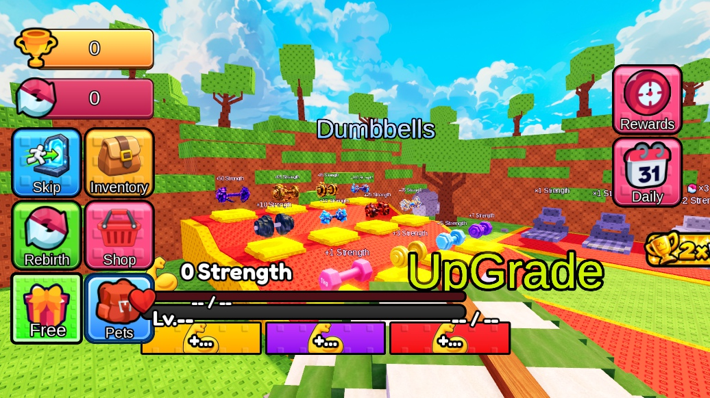
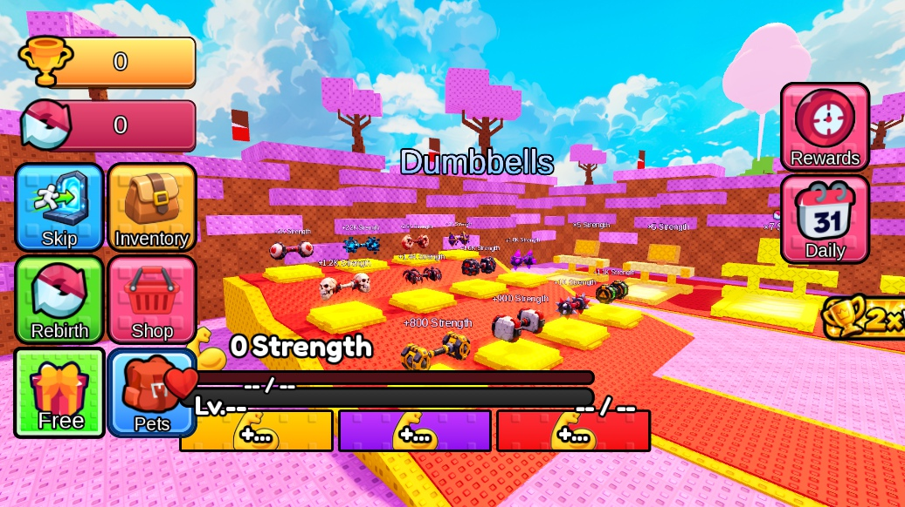

# World1 / World2 ダンベル3D・展示調整 統合報告

2026-11-17。**World1全12種類・World2全12種類の3D展示を副本Editへ反映済み。World2の05/09登録、展示1.5倍、今回の高さ調整・テキスト整理・Strength略記をまとめた最新報告。**

接続実値は PlaceId **126576845524886** / UniverseId **10765181857**。今回の開始HEADは `5912059ccc86ac070a83067ff271341a6be52710`。既存の未保存編集を基準に必要な差分だけを反映した。

## 最終的な表示

- **展示サイズ**：全長7.2 studs（以前の4.8の1.5倍）。縦・横・厚みを同倍率で拡大した状態を維持。
- **展示位置**：Pressからのlocal Yを **8.4 → 4 studs**、全24種類を **4.4 studs下げた**。モデル下端と実ボタン上端の隙間は **1.1085〜1.9950 studs**。ボタンへ埋めていない。
- **設備UI**：Win価格の数値とアイコン行、未所持時の「Step to buy」を表示から除去。Strength説明はモデル上部。Owned / Equippedの所持・装備状態は維持。
- **Strengthの単位**：インベントリ・マージと同じ `NumberFormat.Format` を使用。1,000→1K、1,800→1.8K、1,000,000→1M。既存の小数1桁の丸めにより1,250→1.2K、2,250→2.2K。実際のStrength値は丸めない。
- **手持ち**：既存の装備ItemIdに追従する左右1本ずつ。HeldLength=2、小Bodyの追加厚み1、大Bodyの追加厚み上限1.5を維持。今回の展示高さ変更を手持ちへ適用していない。
- **World1の05**：引き続き既存3Dモデルを利用。World2の05は新規登録した髑髏モデルであり、別ItemIdとして扱う。

Win行は既存GUIオブジェクトを保持してVisible=falseにし、購入処理が参照する構造を壊さず表示から除いた。購入促しはクライアント更新時にも空文字へ設定する。所持・装備を切り替えてもWin行やStep to buyを戻さない。

設備のStrengthは従来クライアントだけ生の数値文字列だったため、共通略記へ揃えた。Editに残っていた古い文字列も、現在のDumbbellItemMasterのStrengthBonusから描き直した。Masterの数値定義、加算、価格、購入資格、装備、マージ、売却、保存、進捗を変更していない。

## 最終のEdit画面

画像は既に開いている副本StudioのEdit描画。HUDが一部を覆うため、全角度や実端末操作の確認とは扱わない。

## World2の05 / 09を含む登録結果

05は既存UIと同じ白い髑髏・赤い棘・骨の柄を持つ水平な129491e9を描画比較で採用。別髑髏d359c5a6は異なる形状の未使用素材として保持。09はユーザー指定の目玉1d5bb350。05は既存GLBを再利用し、09だけFBXから変換した。追加アップロードはModel2件、どちらもOwner User 7467238848、Active / Approved。

| ItemId | 元ファイルのUUID | Model / Mesh ID |
|---|---|---|
| W2_NORMAL_01 | be9de5d1-da96-4257-b9fa-0e9cfc268e96 | 120423306946269 / 72012182548192 |
| W2_NORMAL_02 | 699aff5d-dfc7-47af-8c04-3d2fc97fbd2d | 102716104784959 / 117246680201459 |
| W2_NORMAL_03 | c29ae88b-713b-40c8-a674-7cc619ae9784 | 128085702169072 / 121454316614909 |
| W2_NORMAL_04 | 325c88e5-35ce-4599-abbc-d6add5edffa0 | 117230570003114 / 128283127982055 |
| W2_NORMAL_05 | 129491e9-6098-49c1-85c7-bb7dda049030 | 72432008607429 / 82927178003009 |
| W2_NORMAL_06 | 15b4b34a-ee7b-4724-a23d-840821ad4b01 | 76372035088717 / 110179195904955 |
| W2_NORMAL_07 | 6f4d6c73-89cb-4430-a575-6c6cdf56fdd4 | 79273947117738 / 134262823105301 |
| W2_NORMAL_08 | c0336e3e-4fa8-4e1b-8c0d-8ec6e1aa5dc5 | 127996101926091 / 102402230962981 |
| W2_NORMAL_09 | 1d5bb350-b333-46b5-97b0-f61929c85f98 | 76842591874956 / 71030764434000 |
| W2_NORMAL_10 | 45523401-b6e5-40be-886e-87653b1ca616 | 89304737924828 / 107482140752258 |
| W2_NORMAL_11 | 850c42fe-67c0-4846-9611-d1d1e7b1c6c0 | 115656579181767 / 80759512986628 |
| W2_NORMAL_12 | 1f4b4e93-389d-433a-a119-495af875a4b4 | 121212954959648 / 115333744093861 |

4テクスチャの全ID・元ファイルのSHA256・現在の素材パスは [ASSETS.json](ASSETS.json)。05の取得時ZIPはtripo_convert_129491e9-6098-49c1-85c7-bb7dda049030.zip。09は展開済みFBX＋5 JPGで受領し、ZIPは提供されていない。素材集約先は `C:\Users\kouji\Downloads\World2Dumbbells_20261117`。元素材の形状・色・装飾を変更していない。

[05/09の選定比較・アップロード結果・手持ちEditプレビュー](W20509_IMPLEMENTATION.md)。両メッシュと8テクスチャは取得Success。Roughness/MetallicのGLBチャンネルと元画像の全画素差は0。文字列だけの先行PreloadでFailureだったことも記録し、その後ImageLabel経由で8件成功を確認した。

## Full Path / 手動調整

今回変更した4 Source：

1. `ReplicatedStorage.Config.World1DumbbellVisualConfig`
2. `ReplicatedStorage.Config.World2DumbbellVisualConfig`
3. `ServerScriptService.Services.World1DumbbellVisuals`
4. `StarterPlayer.StarterPlayerScripts.Services.DumbbellStandClient`

登録原本は `ServerStorage.World1DumbbellModels` と `ServerStorage.World2DumbbellModels`。展示は `Workspace.PerStepButtons.<1..12>.World1DumbbellExhibit`、`Workspace.World2Map.TrainingArea.DumbbellDisplays.PerStepButtons.<1..12>.World2DumbbellExhibit`。ラベルは各設備のBillboardGui。手持ちは既存DumbbellDisplayControllerがCharacterのTrainingDumbbellLeft / Rightへ複製する。

| 設定場所 | 現在値・単位 |
|---|---|
| 各WorldのVisualConfig.Items.<完全ItemId>.DisplayLength | 7.2 studs。展示のみ |
| 同.DisplayOffset | (0,4,0) studs、Pressのlocal座標基準 |
| 同.DisplayRotation | (0,0,0)、local軸degrees |
| VisualConfig.ExhibitLabel | Width=9、Height=2.25、Gap=0.6 studs |
| 同.HeldLength / HeldThicknessMultiplier | 2 studs / 1 |
| VisualConfig.BodyThickness.MaxMultiplier | 1.5。Body全体倍率とは別の追加厚み上限 |

例：W2の09だけさらに0.5 studs下げるなら `Items.W2_NORMAL_09.DisplayOffset=Vector3.new(0,3.5,0)`。手持ちの握り位置を変えるなら同じ行のGripOffset。展示の手動調整で大きなモデルがボタンに埋まらないことを確認する。

ラベル枠はモデル上端から計算し、ボタンとともに移動する。WinのAmount行と未所持Status行は非表示。非表示行の空白を減らすため、枠の高さを3.6から2.25 studsへ縮小し、Strength行の実寸高さ1.26 studsを維持した。

設定は新しいPlay/server開始時に再読込される。実行中のrequireキャッシュは強制更新しない。Editへ即反映する場合は最新SourceでRefreshExhibitを呼ぶ。今回のEditは反映済み。

World2登録原本の復元は [InstallWorld2DumbbellModels.luau](../../tools/InstallWorld2DumbbellModels.luau)。全12件の実アセットIDから不足原本だけを復元し、既存原本を上書きしない。復元後、最新Sourceの共通処理が展示・両手を生成する。巨大FBX/GLBはGitへ含めない。

## 今回の確認と限界

[今回の生結果](LOWERED_DISPLAY_CHECKS.json)：

- Editの実寸で24種類すべて4.4 studs下降、サイズ不変。ボタンとの最小隙間1.1085 studs。
- 24設備でWin行非表示、Step to buyなし、Strengthの共通略記を確認。
- 最新のDumbbellStandClientそのものを、切り離したUIコピーとメモリ上のRemote代替で実行。未所持／W2の05所持／W2の09装備／W1の05へ切替の **4状態×24件＝96確認**。Owned/Equipped、Strength、非表示が更新後も維持。
- この96確認は **Editでの模擬検証**。実通信・実購入・実Player・Playではない。
- 購入設備168 Partの位置・寸法・衝突/接触/Query属性を保持。モデルは非衝突・非接触・非Query。
- 手持ち用Clone/AttachのSourceと手持ち設定は変更なし。今回4 Source以外の523 Sourceを開始時の未保存状態と照合して保持。

**今回の実Playは未実施**。新しいRoblox Studioは開かず、保存処理のある副本でPlayも開始していない。05/09追加後と今回の配置/UI変更後の、実装備遷移、Lobby/World往復、死亡復帰、Body移動・Treadmill、2クライアント相互表示、実スマホ/タブレット・公開環境・本番保存は未確認。

前段の隔離Play289項目はWorld2登録10種類の時点の証拠であり、今回の追加2種類や表示変更のPlay合格として数えない。8番UI画像112266643972428は共通設定へ反映済みだが、実インベントリ/マージ画面での新画像描画は引き続き未確認。

## 先行Body調査の結論（今回変更なし）

筋肉最小Bodyの旧低速はfixtureのMeshSize/InitialSize欠落が原因。補完した同条件比較で装着1.1478→24.0373、非装着1.7248→23.9832 studs/sへ復帰し、WalkSpeedや本体寸法を変えていない。

通常成長最大Bodyの旧Treadmill不成立は仮設判定帯0.8と実設備15の相違。一方、実World1設備のジャンプ中加算は本体の支持面・垂直状態判定を修正済み。前段の実測・Strengthメモリ更新・未確認範囲は [BODY_PHASE.md](BODY_PHASE.md) と [REPORT.md](REPORT.md)。今回この本体処理を変更していない。

## 提出・保持

5番/9番の登録は `5912059`、その前の展示1.5倍は `68e4c8f` としてorigin/mainへ通常push済み。今回の高さ・ラベル・略記も別の通常commit/pushで追記し、過去の履歴や証拠を書き換えない。

一時検証用UI・メモリhelperを除去し、副本は既存編集を保持した未保存Editで開いたまま。[最終保持確認](LOWERED_DISPLAY_FINAL.json)。Place Save/Publish・正本・PR #1・force pushは操作していない。無関係なcrashes/は保持し、今回のcommitへ含めない。
