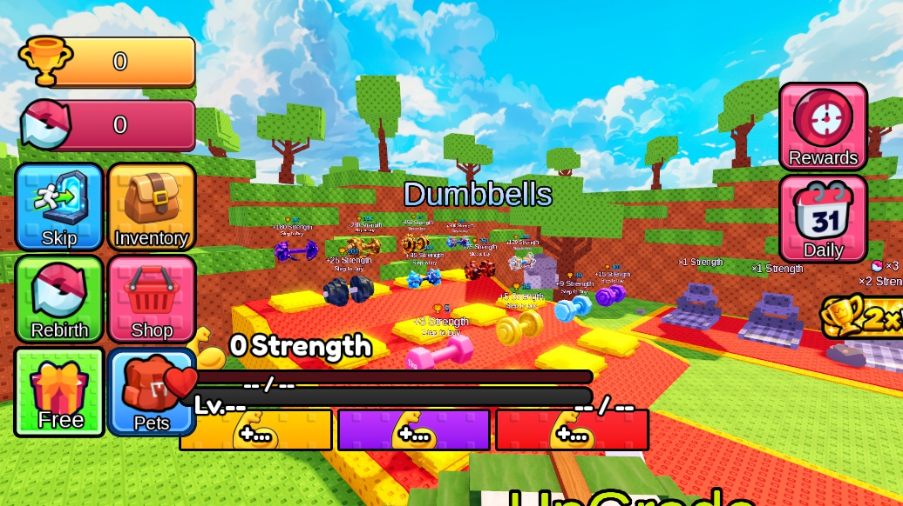
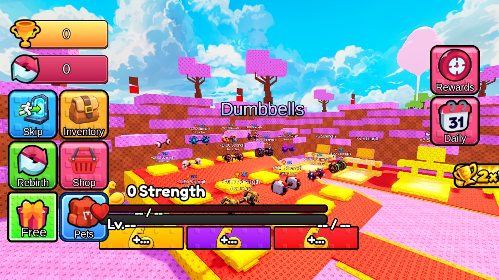

# World1 / World2 展示1.5倍・モデル上のテキスト

2026-11-17。副本 PlaceId **126576845524886** / UniverseId **10765181857** の現在の未保存Editへ反映。開始時HEAD/origin/mainは `022a2631c5cf56fd280dd328a33babd1286df02c`。既存編集を維持し、Save/Publish・正本・PR #1は操作していない。

## 今回の反映

登録済みの **World1全12種類、World2の10種類（01/02/03/04/06/07/08/10/11/12）** の展示を、変更前の縦・横・厚みの1.5倍へ変更した。展示の軸方向全長は4.8 → **7.2 studs**。World1の05は同じ既存原本を使用する。

価格・Strength説明・購入状態の3行を、モデルの実際の上端より上へ移動した。文字枠の下端とモデルの上端の間は **0.6 studs**。隠れていた画像行をレイアウトから除き、3行の元のworld-space高さを維持する。文字内容・画像ID・購入Partを変更しない。World2のテンプレート再適用、World1の既存浮遊処理が表示位置を戻さないよう、登録展示のラベルだけを対象にした。

手持ちは **HeldLength=2、小Body追加厚み1、大Body上限1.5** を維持。展示倍率を手持ちやBodyへ流用しない。原本から複製するため、更新を繰り返して倍率を累積させない。

## Full Path / 手動調整

- `ReplicatedStorage.Config.World1DumbbellVisualConfig`
- `ReplicatedStorage.Config.World2DumbbellVisualConfig`
- `ServerScriptService.Services.World1DumbbellVisuals`（両World共通の既存処理）
- `ReplicatedStorage.Modules.DumbbellStandPresentation`
- `StarterPlayer.StarterPlayerScripts.Services.FloatClient`
- `Workspace.PerStepButtons.<1..12>.World1DumbbellExhibit` と同じ設備の `BillboardGui`
- `Workspace.World2Map.TrainingArea.DumbbellDisplays.PerStepButtons.<対象番号>.World2DumbbellExhibit` と同じ設備の `BillboardGui`

設定は各WorldのVisualConfigへ集約：

| 設定 | 単位・現在値 |
|---|---|
| Items.<完全ItemId>.DisplayLength | 展示の軸方向全長、7.2 studs。全軸を同じ倍率で拡大 |
| Items.<完全ItemId>.DisplayOffset / DisplayRotation | Press基準のstuds / local軸degrees。現在値維持 |
| ExhibitLabel.Width / Height | 文字枠のworld-space寸法、9 / 3.6 studs |
| ExhibitLabel.Gap | モデル上端から文字枠下端の余白、0.6 studs |
| HeldLength / HeldThicknessMultiplier / BodyThickness | 既存手持ち用。今回変更なし |

例：W2の08だけ展示をさらに大きくするなら `Items.W2_NORMAL_08.DisplayLength=8`。文字の余白だけ広げるなら、そのWorldの `ExhibitLabel.Gap=1`。文字位置はモデルの回転を含むBoundingBox上端から再計算する。

Configの変更は新しいPlay/server開始時に読み直す。実行中のrequireキャッシュは自動更新されない。Edit表示も即更新したい場合は最新Sourceで `RefreshExhibit(stand,true)` を実行する。今回の副本Editは既に更新済み。原本復元は既存の [InstallWorld2DumbbellModels.luau](../../tools/InstallWorld2DumbbellModels.luau) を使用し、未登録番号を勝手に割り当てない。

## 今回確認した範囲

**Studio Editでの実形状・Source確認**：[全22種類の変更前後寸法](EXHIBIT_SCALE_EDIT.json)。

- 22種類すべてで実寸の各軸比率1.5、全長約7.2。手持ち複製は約2 studs。
- 全ラベル枠下端とモデル上端の間隔は0.599999〜0.600001 studs。
- 展示各1個、元画像行はVisible=false / ImageTransparency=1。二重展示なし。
- 実際のDumbbellStandPresentation.Applyを再実行してもラベル寸法・位置を維持。
- RefreshExhibitの再呼出しでモデル重複・追加拡大なし。
- 手持ち複製のAnchored=false、CanCollide/CanTouch/CanQuery=false、Massless=true。
- 保護した設備168 Partの位置・寸法・衝突/接触/Query属性と、72の既存テキスト内容が一致。
- 527 Source中、今回の5本だけ変更。他522本は開始時の未保存Sourceを保持。
- 未登録W2の05/09の旧展示UIは維持。

**今回の実描画**：新しいアプリやPlayを開かず、既に開いている副本StudioのEdit画面を取得した。モデル拡大と上方ラベルを確認。HUDが一部を覆うため、画像単体で全番号の細部や全角度を確認したとは扱わない。

**今回の実Playは未実施**。ローカルアプリを勝手に開かないという指示を保持し、新規Studio/Blenderを起動していない。既存副本で保存処理を残したままPlayすることもしていない。前段の289項目の隔離Playは今回の新しいラベル変更の合格証拠ではない。実端末、全角度の重なり、実行中の更新順序、変更後の2クライアント描画は未確認。

## 継続中のWorld2 05 / 09

**09は対応確定済み**。ユーザー指定の `1d5bb350-b333-46b5-97b0-f61929c85f98` をW2_NORMAL_09として扱う。元FBXとBaseColor/Normal/Roughness/Metallicを含む5 JPGが、指定の集約フォルダー内に存在する。FBX SHA256は `ef0350fb7fa543736b7a0eeb0ec51b7d7178abfb936027c24439a6c3a9a27b11`。[入力記録](W209_INPUT.json)。

09のRobloxモデル登録・展示・手持ちへの反映はまだ未完了。既存の変換用Blenderは接続されておらず、ウィンドウを出さないバックグラウンド起動の可否を質問中。「ローカルを開かない」というユーザー指定に従い、返答前には起動しない。ファイルやアップロード権限の拒否が原因ではない。未取得のアセットIDを記入していない。

05は引き続き、異なる2つの髑髏モデル `129491e9-6098-49c1-85c7-bb7dda049030` / `d359c5a6-d5f2-4e22-bb90-1b79bf0dcf09` の対応確認が残る。09が確定したことを理由に、残ったモデルを05へ自動割当していない。

したがって「World2全12種類の新3D実装完了」とは扱わない。8番UIの実画面確認など、前段からの未確認事項は [本報告](REPORT.md) と [画像報告](UI08_AND_MATERIALS.md) を参照。

## 終了状態

検証用のInstanceやScriptを副本へ追加していない。一時的な検証用_Gは最終確認後に除去。[最終保持確認](EXHIBIT_SCALE_FINAL.json)。副本は未保存Editで開いたまま。今回の5 Source、報告・設定仕様・確認画像だけを通常commit/push対象とし、無関係なcrashes/や巨大素材を含めない。
