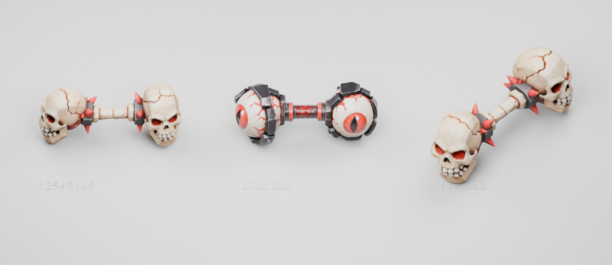
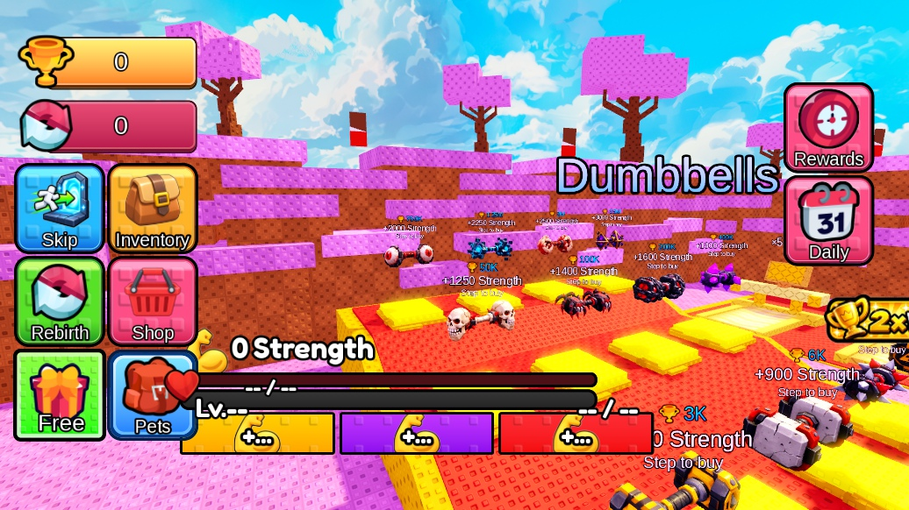
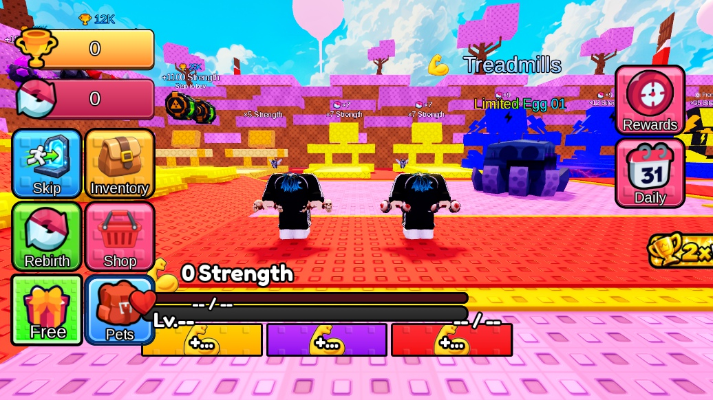

# World2 05 / 09 の登録・Edit反映

2026-11-17。副本 PlaceId **126576845524886** / UniverseId **10765181857**、Owner User **7467238848**。開始時HEAD/origin/mainは `68e4c8f8f988427e5995cc003d51364f5a5217bc`。現在の未保存編集に差分を追加し、巻き戻していない。

前回05/09のEdit表示が変わっていなかったのは、モデル原本と登録行が未追加だったため。今回は両方を登録し、**World2全12枠の3D展示が揃った**。以前の「ローカルを開かない」はRoblox Studioだけの制約というユーザーの訂正に従い、Blenderをウィンドウなしで実行した。新しいStudioは開いていない。

## 採用モデル・実アセットID

| ItemId | 元ファイルのUUID | Model ID | Mesh ID |
|---|---|---:|---:|
| W2_NORMAL_05 | 129491e9-6098-49c1-85c7-bb7dda049030 | 72432008607429 | 82927178003009 |
| W2_NORMAL_09 | 1d5bb350-b333-46b5-97b0-f61929c85f98 | 76842591874956 | 71030764434000 |

| ItemId | BaseColor | Normal | Roughness | Metallic |
|---|---:|---:|---:|---:|
| W2_NORMAL_05 | 120439373379444 | 78146366342005 | 114004727940296 | 90383938174375 |
| W2_NORMAL_09 | 81050513443457 | 134443934692282 | 83262372304448 | 79015952266101 |

Modelアップロードは **2回**、いずれもOwner 7467238848、Active / Approved。[API結果](W20509_UPLOADS.json)。テクスチャはGLBに埋め込み、インポーターが各4 IDを作成。個別画像の追加アップロードや既存10モデルの再アップロードはしていない。

05は既存UI「髑髏と赤い棘のダンベル.png」と描画した2候補を比較。白い頭蓋・赤い眼窩と棘・黒い留め具・骨の柄が一致し、柄が水平な129491e9を採用した。これは視覚比較に基づく選択で、ユーザーがUUIDを直接指定したものではない。別の髑髏d359c5a6も同じ意匠を持つ別形状であり、内容の重複ではないため素材として保持し、未アップロードとする。UUIDの並び順や09を除外した消去法で選んでいない。

09はユーザーの明示指定。追加フォルダーのFBX＋5 JPGを使用し、一覧画像から作成していない。09のZIPは受領しておらず、展開済みファイルを入力と記録した。05の取得時ZIP名は `tripo_convert_129491e9-6098-49c1-85c7-bb7dda049030.zip`、現在は既報の整理によりFBXとテクスチャを展開状態で保持。

素材は引き続き `C:\Users\kouji\Downloads\World2Dumbbells_20261117\World2\originals\<UUID>`、アップロード用GLBは同じWorld2内のexports。05は既存GLBを再利用。09だけを新規変換し、既存12 GLBや旧PreparedManifestを一括生成し直していない。05は13,879 triangles、09は13,498 triangles。減ポリゴン・再着色・装飾変更なし。元の4マップを対応させ、Metallic/RoughnessだけをGLB規約の別チャンネルへ梱包。原点は握り中央、柄をlocal Xへ揃えた。

## 変更Full Path / 設定

- **ReplicatedStorage.Config.World2DumbbellVisualConfig.Items.W2_NORMAL_05 / W2_NORMAL_09**：今回唯一の製品Source変更。
- **ServerStorage.World2DumbbellModels.W2_NORMAL_05 / W2_NORMAL_09**：各1個の登録原本。MeshPart＋SurfaceAppearance＋透明なGripのみ。
- **Workspace.World2Map.TrainingArea.DumbbellDisplays.PerStepButtons.5.World2DumbbellExhibit**
- **Workspace.World2Map.TrainingArea.DumbbellDisplays.PerStepButtons.9.World2DumbbellExhibit**
- 上記2設備の **BillboardGui**：既存共通処理で3D上方へ配置、旧ItemIconを非表示。
- 実行時の手持ちは既存 **Workspace.<Character>.TrainingDumbbellLeft / TrainingDumbbellRight**。既存DumbbellServiceとDumbbellDisplayControllerの装備ItemIdを使う。別の装備処理や更新ループは追加していない。

両モデルの設定は既存10種類と同じ：**DisplayLength=7.2 studs**、DisplayOffset=(0,8.4,0)、DisplayRotation=0。展示のみ以前の4.8から1.5倍相当、ラベル下端はモデル上端から0.6 studs上。

手持ちは **HeldLength=2 studs、HeldThicknessMultiplier=1**。既存BodyPrototypeの全体倍率と、BodyThicknessの追加厚み（小Body=1、大Body上限1.5）は別。今回も横幅を追加厚みで伸ばしていない。例：05の展示位置だけ上げるなら `Items.W2_NORMAL_05.DisplayOffset=Vector3.new(0,9,0)`、握り位置だけずらすなら `GripOffset=Vector3.new(0,-0.1,0)`。回転はdegrees、位置・長さはstuds。

設定変更は新しいPlay/server開始時にrequireし直す。今回のEdit展示は最新Sourceを評価して即反映した。既存requireキャッシュを実行中に強制更新する仕組みは追加していない。

復元は [InstallWorld2DumbbellModels.luau](../../tools/InstallWorld2DumbbellModels.luau)。今回2件を追加して全12件を復元可能にした。既存原本は保持し、登録ID不一致なら停止。ネイティブMeshPart/SurfaceAppearanceを利用し、握り位置・寸法を復元する。PlaceのSave/Publishは行わない。[全12件のUUID・元ファイル・メッシュ・4テクスチャID](ASSETS.json)。

## 今回の確認

**実際のEdit描画・アセット読込**：

- 両メッシュのContentProvider取得はSuccess。
- 8テクスチャを一時ImageLabelへ設定してPreloadし、8件ともSuccess。文字列だけの先行Preloadは8件Failureだったため、その結果も記録している。最初から全呼出し成功とは扱わない。
- GLBのRoughness緑チャンネル・Metallic青チャンネルを元の各JPGと全画素比較し、両モデルとも最大差0。[チャンネル対応確認](W20509_GLB_CHANNELS.json)。
- ネイティブSurfaceAppearance付き展示で、05の髑髏・赤い棘と09の目玉・黒い枠を実描画確認。
- 全12設備の完全ItemId、原本と展示のMeshId一致。05/09の旧画像が重なっていない。

**Edit内の構造・模擬確認**：[生の結果](W20509_EDIT_EVIDENCE.json)。

- 05展示寸法7.2000 × 2.9423 × 2.7263、09は7.2000 × 3.0752 × 3.1455 studs。
- ラベル余白は05=0.60000038、09=0.60000002 studs。
- 実際のVisuals.Attachを左右へ実行し、正しいMeshIdとHandWeldの接続を確認。
- Body全体倍率引数1/2では、手持ちの横幅2/4、追加厚み1/1.5。これは倍率引数の確認で、実際の最大Body生成・移動試験ではない。
- 手持ち全PartはAnchored=false、CanCollide/CanTouch/CanQuery=false、Massless=true。外部ジョイント・Scriptなし。
- RefreshExhibitを繰り返しても重複・再拡大なし。既存219 Partの位置・寸法・接触等を保持。
- 527 SourceのうちConfig1本だけ変更し、他526本を開始時と照合して保持。World1の12モデルと5番既存原本、既存World2の10原本も保持。

下の画像は既存CurrentAvatarReferenceの**静止コピー**に共通Attachで左右へ持たせたEditプレビュー。初回撮影は読込前で表示が確認できなかったため、Preloadと待機後に再撮影した。通常Body/最大Bodyの実Play結果と混同しない。プレビュー用のコピーは撮影直後に削除。

**実Play・未確認**：

今回、新しいRoblox Studioは起動せず、保存処理がある副本でPlayも開始していない。05/09を実装した後の実装備変更・Lobby出入り・World往復・死亡復帰、実アニメーション追従、通常/最大Bodyでの移動・Treadmill、2クライアント相互表示、実端末/公開環境は未確認。

前段の隔離2クライアント289項目は既存10種類の時点の証拠。今回05/09の新規Play合格として数えない。8番UIのインベントリ/マージ画面での実描画も引き続き未確認。今回の変更は登録と表示だけで、価格・加算倍率/周期・購入/マージ/売却/保存・Body/TrainingManagerのSourceを変更していない。

## 終了状態

一時Rig・ImageLabel・検証用_Gを除去。[最終保持確認](W20509_STUDIO_FINAL.json)。副本は未保存Editで開いたまま。既存未保存編集を保持し、Place Save/Publish、正本、PR #1、force pushを行っていない。今回のConfig登録2行群、原本復元用ID、報告・画像だけを通常commit/push対象とする。巨大素材や無関係なcrashes/は含めない。
