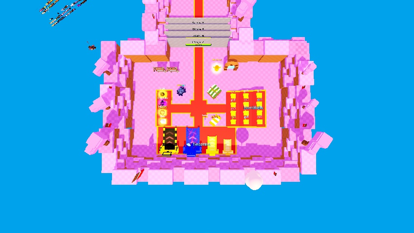
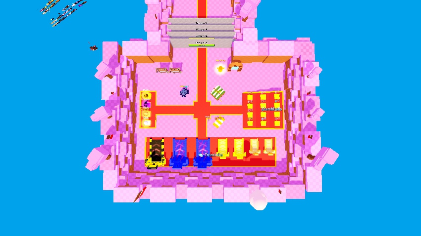
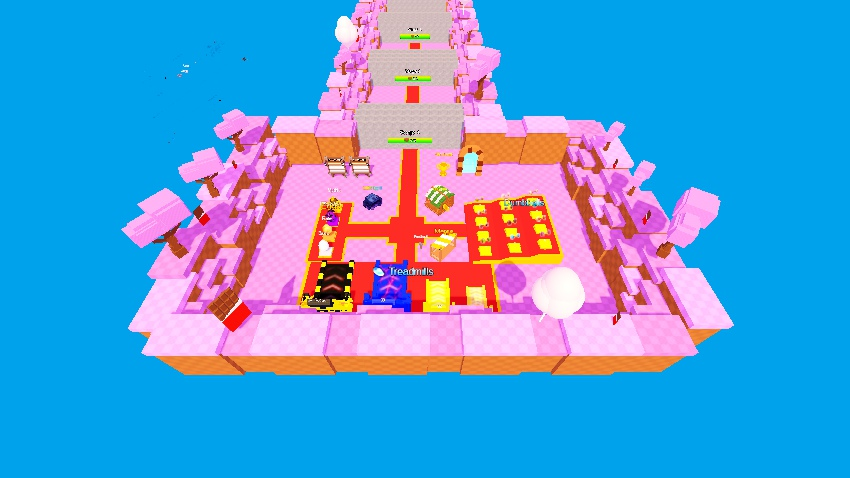
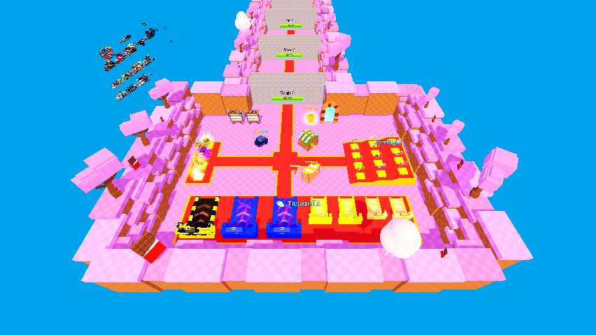

# World2 lobby depth and seven-machine row — 2026-10-19

## Actual input and outcome

- Input/output: `C:\Users\kouji\MergeToForge_CurrentCloud.rbxl`. Only this same file was written; no other rbxl, backup, copy or migration file.
- Actual input SHA-256: `a9d875ec82c7b043774f80402195b35fd1ca62c50fdf11fc3f1473389e9dc646`. It differs from the earlier ed3c93e output; the current file, including its newer unrelated content, was used directly.
- Final SHA-256: `e25dc9e34a46a4021bded4ceec8405ba042c77a5c47a2791534860e52e94e650`.
- Existing floor: **237 x 149 studs**, top Y2. Completed floor: **237 x 169**, top Y2. **Width unchanged; depth extends 20 studs toward the treadmill side.**
- Existing four installed purchased machines were reused. Only the missing second copy of old 01, 02 and 03 was added. No old generator was rerun and no reference rbxl import was needed.
- Scope is geometry and display metadata only. All original gameplay Sources, World1, Stage01–10, BattleCorridor, connector, Spawn and return Gate remain unchanged.

## Width decision and depth calculation

Directions come from the actual Stage entrance and plaza: Stage is +Z, treadmills are -Z, Dumbbells are -X and normal Eggs are +X. In the requested overhead view, Stage is up, treadmills down, Dumbbells right, Eggs left.

| Measurement | Studs |
|---|---:|
| Current floor width | 237.000 |
| Wall/column inner X bounds | -99.710 to 128.950 |
| Effective inner width | 228.660 |
| Seven native body widths combined | 158.695 |
| Six machine gaps | 6.000 each /36.000 total |
| Minimum desired end clearances used for the fit decision | 8.000 each |
| Required width with those clearances | 210.695 |
| Actual equal end clearance within the retained walls | 16.983 each |

The required 210.695 studs fit within 228.660. A narrow old pad is not used as a reason to widen the lobby. The row is centered within the existing wall interior; the pad alone widens to 202.695 studs, with native carpet border widths/heights retained. No machine scaling or extra row.

The nearest retained side-facility rear edge is Z1917.738. Leave 12 studs between that edge and the front of the treadmill pad, plus a 2-stud pad apron after the common machine front. The common front is therefore Z1903.738. The deepest machine is 42.532 studs; six studs behind it plus the native rear-wall intrusion requires 168.953 studs of floor depth. Round upward to **169**, giving an actual **6.047-stud rear clearance**. The Stage edge stays Z2019.979980. No predetermined 190-stud depth or 300-stud width was adopted.

The rear wall and its rear decorations move -Z by 20. Each side wall uses four intact purchased segments instead of three, with native sizes/materials/colors; the side decorations follow the longer boundary. Two native wall segments were added. Exit walls and the Stage connector stay fixed. The floor remains one continuous Part at Y2.

## Seven-machine mapping

The donor paths below refer to the **before-edit** instances. Four existing instances remain; three new individuals are cloned from those inert visual assemblies. Labels show model types 01/01/02/02/03/03/04 Robux, while StationIndex 1–7 and World1Slot metadata distinguish individuals. These are display fields, not product identities.

| Station | World1 slot | Old model type | Existing / added | Before donor full path | Final full path |
|---:|---|---:|---|---|---|
| 01 | Normal01 | 01 | Existing | `Workspace.World2Map.TrainingArea.TreadmillDisplays.01` | `Workspace.World2Map.TrainingArea.TreadmillDisplays.01` |
| 02 | Normal02 | 01 | Added | `Workspace.World2Map.TrainingArea.TreadmillDisplays.01` | `Workspace.World2Map.TrainingArea.TreadmillDisplays.02` |
| 03 | Iron01 | 02 | Existing | `Workspace.World2Map.TrainingArea.TreadmillDisplays.02` | `Workspace.World2Map.TrainingArea.TreadmillDisplays.03` |
| 04 | Iron02 | 02 | Added | `Workspace.World2Map.TrainingArea.TreadmillDisplays.02` | `Workspace.World2Map.TrainingArea.TreadmillDisplays.04` |
| 05 | Gold01 | 03 | Existing | `Workspace.World2Map.TrainingArea.TreadmillDisplays.03` | `Workspace.World2Map.TrainingArea.TreadmillDisplays.05` |
| 06 | Gold02 | 03 | Added | `Workspace.World2Map.TrainingArea.TreadmillDisplays.03` | `Workspace.World2Map.TrainingArea.TreadmillDisplays.06` |
| 07 | Diamond01 | 04 | Existing | `Workspace.World2Map.TrainingArea.TreadmillDisplays.04` | `Workspace.World2Map.TrainingArea.TreadmillDisplays.07` |

All seven entrances face +Z toward the central plaza and share the same front line. In the requested image direction the left-to-right order is **04, 03, 03, 02, 02, 01, 01**. Bodies keep their existing shape, dimensions, rotations, artwork and visual effects. 04 remains a Robux category label only; no price, ProductId, GamePassId, effect or multiplier. 01–03 conditions remain undecided. Old05/06 and unrelated purchased-map bodies are not added.

## Side equipment and route changes

| Whole assembly | X translation | Wall clearance | Retained |
|---|---:|---:|---|
| `Workspace.World2Map.TrainingArea.DumbbellDisplays` (Dumbbells 12) | -19.788 | 4.000 | Internal layout, orientation, Y/Z, signs and UI |
| `Workspace.World2Map.TrainingArea.FacilityDisplays.EggDisplays` (Normal Eggs 4) | +29.006 | 4.000 | Internal layout, orientation, Y/Z, signs and UI |

Dumbbells move toward image-right (-X); Eggs toward image-left (+X). The Dumbbell Ramp, stairs, twelve Press/platforms, sign and twelve existing ItemIcons move together. Four normal Egg visuals, supports, pad and sign move together. Neither assembly is duplicated. All original image URIs, offsets, fitting/aspect settings and own-Press Adornees are preserved.

Extend only the existing `PathToRun.WestBranch` and `PathToRun.EastBranch`, anchored at their central-plaza ends. Upper widths remain 13 studs; lower widths16. The west upper path length becomes 50.825 and the east upper path60.043. The existing treadmill stem extends to the larger pad; its central-plaza endpoint and X alignment stay fixed. The original four-way route graph is unchanged.

Native visual review caught an initial axis error on the four rotated branch Parts. Their world-X extents were corrected using the corresponding local Size axes, then the same file was re-decoded and reopened. The builder now asserts requested world bounds and unchanged perpendicular spans after every interval resize. Only the corrected final captures are presented below.

Unmoved facilities: `FacilityDisplays.LimitedEggDisplay`, `MergeDisplay`, `UpgradesDisplay`, `WinBoostDisplay`, `TotalRankingDisplay`, `DailyRankingDisplay`, `FeedbackDisplay`, `World1ReturnGate` and `World2LobbySpawn`, all under `Workspace.World2Map.TrainingArea`. No uniform lobby scale or independent rearrangement of these facilities.

Changed object roots (all exact paths):

- `Workspace.World2Map.TrainingArea.Floor`
- `Workspace.World2Map.TrainingArea.Borders.WestWall`
- `Workspace.World2Map.TrainingArea.Borders.EastWall`
- `Workspace.World2Map.TrainingArea.Borders.RearWall1`
- `Workspace.World2Map.TrainingArea.Borders.RearWall2`
- `Workspace.World2Map.TrainingArea.Borders.RearWall3`
- `Workspace.World2Map.TrainingArea.Borders.RearWall4`
- `Workspace.World2Map.TrainingArea.Borders.RearWall5`
- `Workspace.World2Map.TrainingArea.Decorations`
- `Workspace.World2Map.TrainingArea.DumbbellDisplays`
- `Workspace.World2Map.TrainingArea.FacilityDisplays.EggDisplays`
- `Workspace.World2Map.TrainingArea.TreadmillDisplays`
- `Workspace.World2Map.TrainingArea.PathToTreadmills`
- `Workspace.World2Map.TrainingArea.PathToRun.WestBranch`
- `Workspace.World2Map.TrainingArea.PathToRun.EastBranch`

## Validation and limits

- **Static saved-file checks:** 392 Instances added (three machines and two native wall segments); no original Instance removed or reparented.879 rigid Part checks preserve native size/orientation. All original properties outside the allowed scope are equal to the current input. All original Sources are unchanged; no Source syntax change or repository Source replacement.
- **Binary:** 182,083 final Instances, IDs 0..182082; no gaps/out-of-range refs or duplicate UniqueIds. INST,78,372 PROP.Ref values and all PRNT entries validate.362 SharedStrings /208,403 indexes validate. Fresh Decode and a byte-identical second canonicalization pass, including the four-Part path correction.
- **Native Studio Edit:** exact corrected file reopens normally. Seven models in 2/2/2/1 order, six 6-stud gaps and a common front line are verified in the engine. Both side assemblies have 4-stud wall clearance; branch widths remain 13/16. Twelve Dumbbell images each report Success and IsLoaded=true and keep their own Press Adornee. Thirty floor rays hit Y2, including the extended area. Same-camera before/after and eye-height entrance views confirm the final presentation and connections.
- **Display isolation:** the moved/new equipment has zero copied Sources, prompts/remotes, unsafe product/item/pass/value attributes, training tags, active buttons, moving/touch-enabled Parts or external GUI Adornees. Actual current Dumbbell/Egg/Treadmill selectors use direct World1 roots; Training additionally requires TrainingTreadmill and a valid Config entry. New nested models do not meet those selectors. DisplayOnly alone is not treated as the safeguard.
- **Not verified:**Cloud walking, physical mounting/dismounting, live Gate travel, real purchase/equip/Training/save or every runtime camera/device. Static gaps/rays and Edit screenshots are not walking or operation tests. No local Play, Studio Save or Publish was performed.
- Temporary camera/GUI/reference-library visibility was restored. Only owned audit/verification Studios were closed without saving. User Studio 1395d9d1-323d-4792-84dc-5194c5a58099 remains untouched. The final file hash remains unchanged and its lock is absent.

## Actual comparison and close views

Unmodified Studio JPEG captures are 850 x478. Both before/after pairs use identical camera and look-at coordinates; Stage is up and treadmills down.

| View | Before | After |
|---|---|---|
| Aerial |  |  |
| Overview |  |  |

[All seven machines](../docs/World2LobbyDepth_20261019/Depth_After_SevenTreadmills_20261019.jpg) · [Type 01 entrances](../docs/World2LobbyDepth_20261019/Depth_After_Entry01_20261019.jpg) · [Type 02 entrances](../docs/World2LobbyDepth_20261019/Depth_After_Entry02_20261019.jpg) · [Type 03 entrances](../docs/World2LobbyDepth_20261019/Depth_After_Entry03_20261019.jpg) · [Type 04 entrances](../docs/World2LobbyDepth_20261019/Depth_After_Entry04_20261019.jpg) · [Dumbbells](../docs/World2LobbyDepth_20261019/Depth_After_Dumbbells_20261019.jpg) · [Eggs](../docs/World2LobbyDepth_20261019/Depth_After_Eggs_20261019.jpg) · [RearClearance](../docs/World2LobbyDepth_20261019/Depth_After_RearClearance_20261019.jpg)

Evidence: [before measurements](World2LobbyDepthBefore_20261019.json), [final geometry/binary manifest](World2LobbyDepth_20261019.json), [native Edit results and camera coordinates](World2LobbyDepthNative_20261019.json), [actual selector excerpts](World2LobbyDepthServicePaths_20261019.json).

Implementation: `tools/world2_lobby_depth.py` is a guarded edit of the exact current input, dry-run by default. It uses only the generic repaired row/geometry/referent codecs and refuses an already modified input. Existing unrelated tracked edits, untracked files and stash are retained; only this task is committed and normally pushed.
