# World2 lobby replica — 2026-10-18

## Authority and scope

The latest owner direction was to first duplicate the actual World1 layout unchanged. Horizontal placement scale is **1.0**, not an independently designed expansion. The new World2 floor matches World1 and is larger than the downloaded World2 floor. The rejected b06e26e layout (377.46 x 252.38, a grid of routes, twelve mixed treadmills) and its layout script were not reused. Historical reports remain historical.

- Input and output: `C:\Users\kouji\MergeToForge_CurrentCloud.rbxl`.
- Downloaded input SHA-256: `448b3f16a929abcbc4db17b8d59fec570821fcbfcd2d874a29ddda4b4031aeb9`.
- Final same-file SHA-256: `cf195c7ff1d7445b7c92f68d454a19fc6409bd61b0fd2e0d991c74b1beddd170`.
- Read-only approved treadmill reference: `C:\Users\kouji\Smash_and_Crush_PreMerge_20261003.rbxl` (unchanged).
- Target Cloud: Place 126576845524886 / Universe 10765181857. No Cloud modification or play was performed.
- Input inspection found no World2 DumbbellDisplays, TreadmillDisplays or FacilityDisplays. This is new construction in the downloaded input, not repair/removal of the rejected equipment.
- No original World1 object/property/Source changed. No Source from Git or the rejected rbxl was applied. No extra rbxl, backup or migration copy was created.

## Measured reference layout

| Measurement | Current World1 | Downloaded World2 | Completed World2 |
|---|---:|---:|---:|
| Floor width X | 237 | 184.34 | 237 |
| Floor depth Z | 149 | 140.18 | 149 |
| Floor top Y | 4 | 2 | 2 |
| Floor thickness | 8 | 2 | 2 |

The World1 reference is the center of its BattleCorridor entrance at **(287.799988, 4, 85)**. Its World2 counterpart is the fixed connector front at **(27.920000, 2, 2019.979980)**. The common translation is **(-259.879988, -2, +1934.979980)**. All ordinary equipment parts retain their original sizes and rotations. There is no model scaling. World2 floor bounds are X[-103.879988, 133.120012], Z[1870.979980, 2019.979980]. Floor area grows from about 25,840.78 to 35,313 square studs (36.66%), by matching the actual World1 footprint.

The common plaza is 25 studs wide on its upper carpet. The BattleCorridor branch and treadmill stem retain the 13-stud upper / 16-stud lower widths. West is the Dumbbell entrance, east is the Egg entrance, -Z is the single treadmill row, +Z is BattleCorridor. Merge and Upgrades retain their two corners beside the west branch; Limited Egg stays on the east/front corner. Feedback, Win Boost, both rankings and the counterpart Gate keep their World1 sides, orientations and adjacency. There are no additional grid branches.

| Facility | World1 center offset from entrance (X, Z) | World2 center offset (X, Z) | Footprint X x Z |
|---|---:|---:|---:|
| Dumbbells | -71.131, -73.019 | -71.131, -73.019 | 65.423 x 58.445 |
| Normal Eggs | 55.024, -71.307 | 55.024, -71.307 | 26.000 x 58.500 |
| Merge | -25.621, -90.810 | -25.621, -90.810 | 18.546 x 19.452 |
| Upgrades | -24.277, -47.797 | -24.277, -47.797 | 22.981 x 25.715 |
| Limited Egg | 27.200, -45.000 | 27.200, -45.000 | 18.866 x 18.866 |
| Win Boost | -28.607, -8.852 | -28.607, -8.852 | 10.816 x 6.352 |
| Total ranking | 58.479, -15.158 | 58.479, -15.158 | 16.500 x 7.000 |
| Daily ranking | 38.878, -15.158 | 38.878, -15.158 | 16.500 x 7.000 |
| Feedback | -10.361, -88.538 | -10.361, -88.538 | 2.700 x 2.704 |

Feedback was selected from the three same-named `Workspace.Mailboxes.Feedback` models by its actual active-lobby position (center X277.439), not by an ambiguous name lookup. Normal Egg supports are the active `Stands` and `EggsStand` under the otherwise old `Workspace.Map.Spawn.PathToEggs`; its retired path branches were not copied.

The intact purchased pink wall segments, materials, colors and plants remain pink. Side wall segments were translated to the new perimeter; one RearWall5 and one ExitLeftOuter repeat native segments without scaling. The two connector shoulders widen to support the new floor edges; the center connector/path and all BattleCorridor/Stage01..10 objects remain unchanged. Existing Gate/Spawn Instances and attributes remain; their position/orientation follow the World1 counterparts. StageProgressController reads those actual Instances and their CFrames, so no hard-coded arrival replacement is required.

## Installed facilities and full paths

All rows below are **display only**. No price, effect, multiplier, probability, unlock condition, product/pass/item ID, purchase, equip, training, hatch, merge, reward or save integration is provided.

| Facility | Count | Actual donor full path | Destination full path |
|---|---:|---|---|
| Dumbbells | 12 | `Workspace.Ramp` `Workspace.PerStepButtons` | `Workspace.World2Map.TrainingArea.DumbbellDisplays` |
| Normal Eggs | 4 | `Workspace.Map.Spawn.PathToEggs.Stands` `Workspace.Map.Spawn.PathToEggs.EggsStand` `Workspace.Eggs` | `Workspace.World2Map.TrainingArea.FacilityDisplays.EggDisplays` |
| Merge | 1 | `Workspace.RestockShop` | `Workspace.World2Map.TrainingArea.FacilityDisplays.MergeDisplay` |
| Upgrades | 1 | `Workspace.ShopStallTemplate` | `Workspace.World2Map.TrainingArea.FacilityDisplays.UpgradesDisplay` |
| Limited Egg | 1 | `Workspace.Chill Octopus` | `Workspace.World2Map.TrainingArea.FacilityDisplays.LimitedEggDisplay` |
| Win Boost | 1 | `Workspace.Trophy` | `Workspace.World2Map.TrainingArea.FacilityDisplays.WinBoostDisplay` |
| Total ranking | 1 | `Workspace.TotalStrengthRankingBoard` | `Workspace.World2Map.TrainingArea.FacilityDisplays.TotalRankingDisplay` |
| Daily ranking | 1 | `Workspace.DailyStrengthRankingBoard` | `Workspace.World2Map.TrainingArea.FacilityDisplays.DailyRankingDisplay` |
| Feedback | 1 | `Workspace.Mailboxes.Feedback` | `Workspace.World2Map.TrainingArea.FacilityDisplays.FeedbackDisplay` |
| Treadmill 01 | 1 | `C:\Users\kouji\Smash_and_Crush_PreMerge_20261003.rbxl :: Workspace.World2Treadmill.Treadmill01` | `Workspace.World2Map.TrainingArea.TreadmillDisplays.01` |
| Treadmill 02 | 1 | `C:\Users\kouji\Smash_and_Crush_PreMerge_20261003.rbxl :: Workspace.World2Treadmill.Treadmill02` | `Workspace.World2Map.TrainingArea.TreadmillDisplays.02` |
| Treadmill 03 | 1 | `C:\Users\kouji\Smash_and_Crush_PreMerge_20261003.rbxl :: Workspace.World2Treadmill.Treadmill03` | `Workspace.World2Map.TrainingArea.TreadmillDisplays.03` |
| Treadmill 04 | 1 | `C:\Users\kouji\Smash_and_Crush_PreMerge_20261003.rbxl :: Workspace.World2Treadmill.Treadmill04` | `Workspace.World2Map.TrainingArea.TreadmillDisplays.04` |

Dumbbell stairs/Ramp, all twelve platforms/Presses, sign and existing ItemIcons were copied as an assembly. No `Workspace.ShoesModels` 3D exhibits were copied. Original World1 exhibits, held Dumbbells and `ServerStorage.Templates.DumbbellDisplayTemplate` are preserved. Normal Eggs retain names/artwork; Limited Egg, Merge, Upgrades, Win Boost, ranking headings and Feedback retain their authored designs. Undefined amounts/row data and input affordances are blank/hidden, while the signs remain.

Not invented: Aura, Rebirth and standalone Shop have no active physical lobby donor in the inspected input; their screen menus are not converted into buildings. Old retired-map mailboxes and board/gift structures are not additional current-lobby donors. All specifically requested physical facilities were found and installed.

## Twelve 2D Dumbbell images

Every Image URI uses `rbxassetid://`. Each copied ItemIcon is connected to the same-number Press, Fit with zero crop and the existing aspect constraint. The board is 9 x 9 studs at (0, 6.5, 0); image84% / number12%. Price/Strength/purchase/state rows are hidden. No World2 definition is added to Master, Shop or Inventory.

| Station | Image name | URI | Full ItemIcon path |
|---:|---|---|---|
| 01 | W2-1D | `rbxassetid://117636801345125` | `Workspace.World2Map.TrainingArea.DumbbellDisplays.PerStepButtons.1.BillboardGui.ItemIcon` |
| 02 | W2-2D | `rbxassetid://87392597068250` | `Workspace.World2Map.TrainingArea.DumbbellDisplays.PerStepButtons.2.BillboardGui.ItemIcon` |
| 03 | W2-3D | `rbxassetid://90484814439233` | `Workspace.World2Map.TrainingArea.DumbbellDisplays.PerStepButtons.3.BillboardGui.ItemIcon` |
| 04 | W2-4D | `rbxassetid://92409856077185` | `Workspace.World2Map.TrainingArea.DumbbellDisplays.PerStepButtons.4.BillboardGui.ItemIcon` |
| 05 | W2-5D | `rbxassetid://76660708269544` | `Workspace.World2Map.TrainingArea.DumbbellDisplays.PerStepButtons.5.BillboardGui.ItemIcon` |
| 06 | W2-6D | `rbxassetid://73514550426804` | `Workspace.World2Map.TrainingArea.DumbbellDisplays.PerStepButtons.6.BillboardGui.ItemIcon` |
| 07 | W2-7D | `rbxassetid://86006626767728` | `Workspace.World2Map.TrainingArea.DumbbellDisplays.PerStepButtons.7.BillboardGui.ItemIcon` |
| 08 | W2-8D | `rbxassetid://101543601215487` | `Workspace.World2Map.TrainingArea.DumbbellDisplays.PerStepButtons.8.BillboardGui.ItemIcon` |
| 09 | W2-9D | `rbxassetid://70465860935084` | `Workspace.World2Map.TrainingArea.DumbbellDisplays.PerStepButtons.9.BillboardGui.ItemIcon` |
| 10 | W2-10D | `rbxassetid://89190858658364` | `Workspace.World2Map.TrainingArea.DumbbellDisplays.PerStepButtons.10.BillboardGui.ItemIcon` |
| 11 | W2-11D | `rbxassetid://135716155094439` | `Workspace.World2Map.TrainingArea.DumbbellDisplays.PerStepButtons.11.BillboardGui.ItemIcon` |
| 12 | W2-12D | `rbxassetid://116813512043021` | `Workspace.World2Map.TrainingArea.DumbbellDisplays.PerStepButtons.12.BillboardGui.ItemIcon` |

## Four approved treadmills in the original row

Only the read-only earlier purchased Treadmill01..04 are imported, one each. Models05/06 and the purchased-map Normal/Iron/Gold/Diamond bodies are not imported. World1 treadmill bodies remain unchanged.

| Destination number | Approved model | Native width x depth | Entrance | Offer display |
|---:|---|---:|---|---|
| 01 | Treadmill01 | 15.888 x 23.924 | +Z | Conditions undecided |
| 02 | Treadmill02 | 19.209 x 28.924 | +Z | Conditions undecided |
| 03 | Treadmill03 | 29.500 x 42.532 | +Z | Conditions undecided |
| 04 | Treadmill04 | 29.500 x 42.532 | +Z | Robux category only |

The original one-row section is 125.517 studs wide. Native body widths total 94.098; all three internal gaps and both end gaps are 6.284 studs. Sequence01→04 follows +X. Model02 was rotated180 degrees because its purchased entrance faced the opposite direction; this aligns all four entrances with World1. No machine was scaled or rearranged into multiple rows.

The shared rear line is World1 Z-58.6 translated into World2. Rear wall clearance is 1.220 studs; this is not claimed as a usable rear walkway. Front01/02 approach space before the Merge back is at least14 studs. Front03/04 open toward the existing plaza/Egg-side floor. The native treadmill pad depth and its existing connecting stem length adapt to these deeper models; their X-axis, widths and branch topology remain. This is the documented model-count/size exception, not a relocation of the section.

Body bottoms are grounded at Y2, within float tolerance. Belt surface heights and native ray/bounds observations are recorded separately in the geometry JSON. No added gameplay or physical walking test is implied. Old x100M / 3x SPEED / OWNER / ADMIN labels are blank; numbered boards show01,02,03 and04 Robux. Conveyor velocity is zero and CanTouch is false.04 has no configured Robux price, ProductId, GamePassId or multiplier;01–03 are not marked free.

## Isolation and validation

- Actual Sources, not repository assumptions, were inspected. DumbbellStandService/Multiplier/Float use the direct Workspace.PerStepButtons/ShoesModels roots. Treadmill services use direct Workspace.Treadmills and TrainingManager additionally requires TrainingTreadmill tags and valid Config entries. Egg services use direct Workspace.Eggs. Merge/Upgrades/WinBoost/Rankings use their direct named World1 roots. Limited Egg prompt binding requires its root directly under Workspace. Feedback requires the direct Mailboxes parent and its Feedback attribute. The new nested display roots, cleared tags/attributes/IDs and removed inputs do not satisfy these conditions. No common Service edits were necessary.
- Binary/geometry: all original World1/other gameplay Sources and object properties remain equal to the downloaded input.383 copied physical parts preserve translation, sizes and rotations (maximum positional float error0.0000611); ranking boards have only a0.20019-stud downward grounding correction. Treadmill substitution/pad depth are the exceptions described above.
- Binary final count181,671; INST IDs0..181670; no gaps/out-of-range refs or duplicate UniqueIds. All78,220 PROP.Ref values and PRNT relations pass the repaired canonicalization and fresh Decode.362 SharedStrings /207,919 indexes are valid. A second canonicalization is byte-identical. Source syntax is not changed because no original Source is edited and copied Sources are excluded.
- Native Studio Edit: the exact written file reopens successfully.12 correct ItemIcons each report **AssetFetchStatus.Success and IsLoaded=true**, with their own Press Adornee. Four imported machines, all requested facilities and displayed labels are verified.527 copied equipment Parts are anchored, untouchable and motionless; zero copied Sources, prompts/remotes, unsafe identifiers, tags, active buttons or external GUI Adornees remain.
- Native geometry:30 floor ray samples hit Y2; center connector top also Y2. Twelve route Parts and eight source/destination facility bound pairs are measured in the engine. Same-direction overhead and front screenshots demonstrate matching sides, order, entrances and shared routes. Actual image proportions and observed label separation are checked at those views.
- **Not verified:** Cloud walking/interaction, real purchase/equip/training/hatch/merge/save, dynamic Gate travel and all-device/runtime camera behavior. No local Play, Studio Save or Publish was performed. Static exclusion checks and Edit rendering are not called runtime passes.
- Temporary camera/ScreenGui/reference-library visibility was restored; only owned audit/verification Studios were closed without saving. The user Studio1395d9d1-323d-4792-84dc-5194c5a58099 was untouched. Final file hash remains equal to the written result and its lock is absent.

## Same-direction comparison captures

Raw Studio captures are396 x222 pixels. Each pair uses the same camera/look direction and the common translation; no image retouching. Close views supplement the whole-lobby comparison.

| View | World1 | World2 |
|---|---|---|
| Aerial | 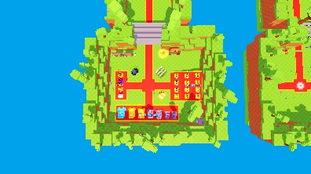 | 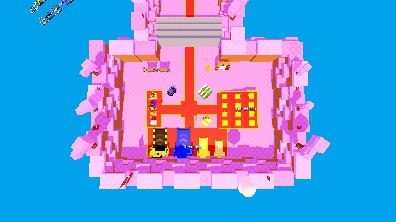 |
| Overview | 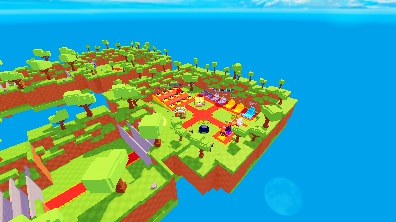 | 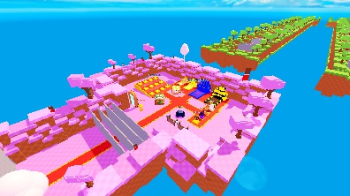 |
| Dumbbells | 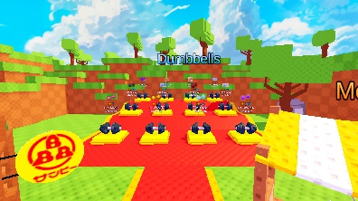 | 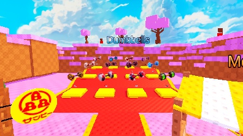 |
| TreadmillRow | 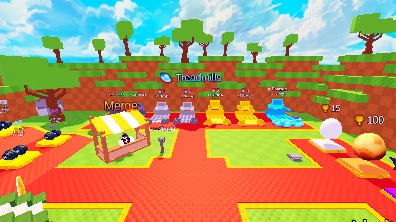 | 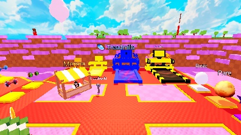 |
| Eggs | 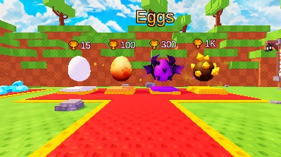 | 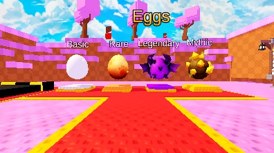 |
| Booths | 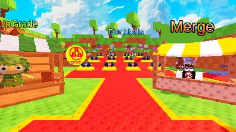 | 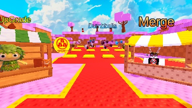 |
| LimitedEgg | 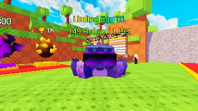 | 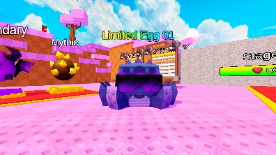 |
| Rankings | 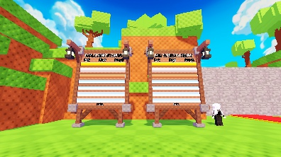 | 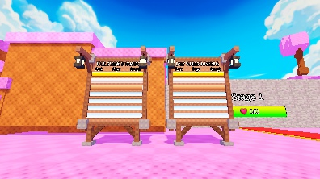 |
| Feedback | 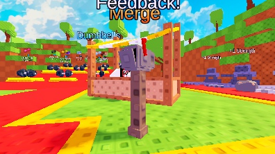 | 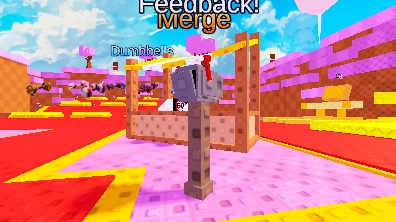 |
| GateBoost | 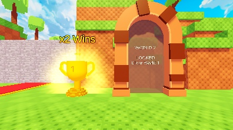 | 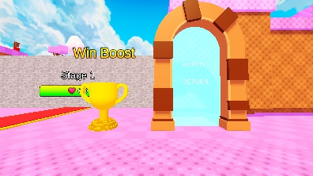 |

Additional World2 detail views: [Treadmill01_02](../docs/World2LobbyReplica_20261018/W2Replica_Treadmill01_02_20261018.jpg), [Treadmill03_04](../docs/World2LobbyReplica_20261018/W2Replica_Treadmill03_04_20261018.jpg), [DumbbellFrontRow](../docs/World2LobbyReplica_20261018/W2Replica_DumbbellFrontRow_20261018.jpg).

## Reproduction and evidence

`tools/world2_lobby_replica.py` is guarded by the exact downloaded input hash, dry-runs by default, and writes only the same input path with `--write` after Studio releases it. It refuses the already modified output and never reads the rejected layout script. It shares only the repaired generic binary/geometry codecs.

- [Measured source/layout, image mapping and binary manifest](World2LobbyReplica_20261018.json)
- [Actual service selection excerpts](World2LobbyReplicaServicePaths_20261018.json)
- [Native Edit images/labels/input isolation](World2LobbyReplicaNative_20261018.json)
- [Native geometry/routes/floor rays/clearances](World2LobbyReplicaGeometryNative_20261018.json)

Only this implementation, evidence and English documentation are committed. The four pre-existing unrelated tracked changes, existing untracked material and stash remain. The rbxl itself remains at the requested path outside the repository.
